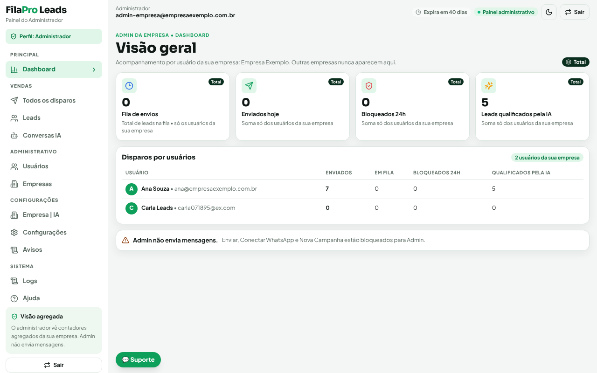
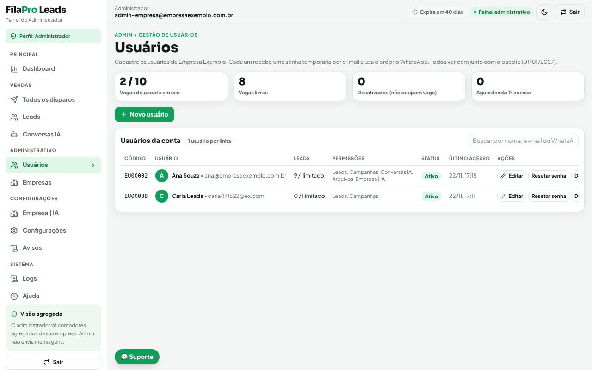
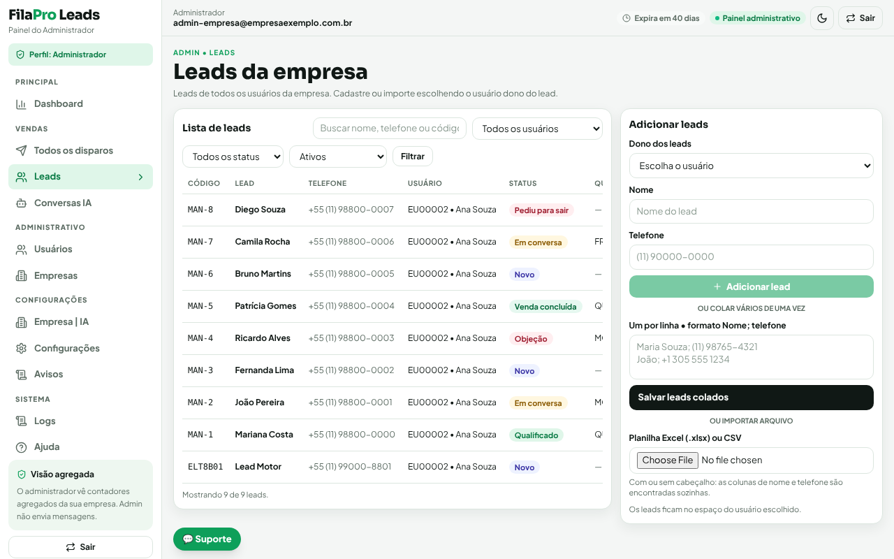
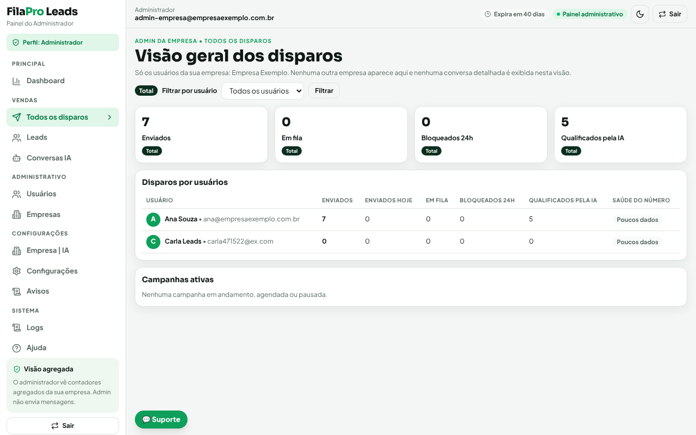
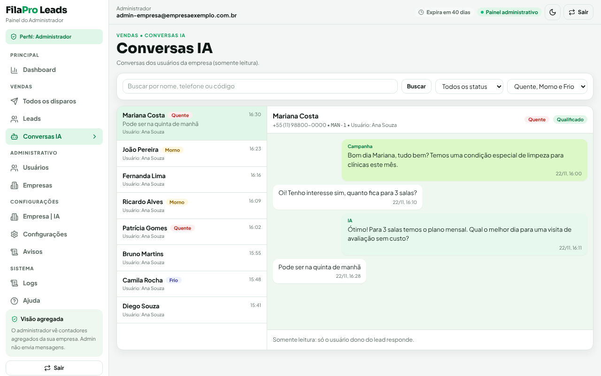
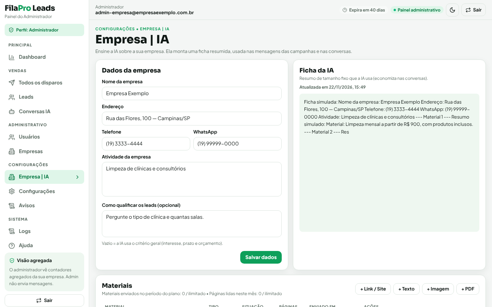
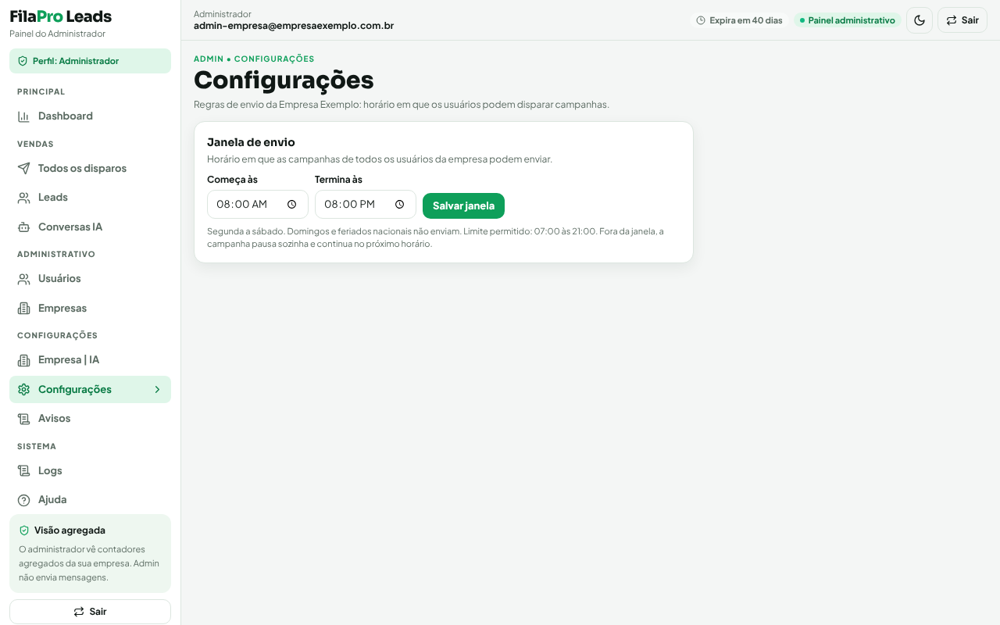
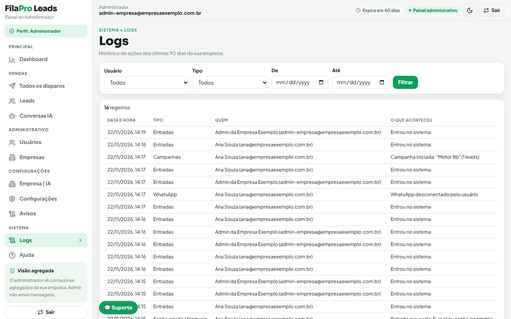

# Manual do Admin da Empresa — FilaPro Leads

Este manual é para o **administrador de uma empresa** no plano **Empresarial**. O Admin **não envia mensagens**: ele cria e
cuida dos usuários (que enviam), acompanha os resultados da equipe, ensina a IA sobre a empresa e define as regras de envio.

Para o passo a passo do que os usuários fazem (campanhas, conversas, WhatsApp), veja o **Manual do Usuário**.

## Primeiro acesso

1. Depois da compra, você recebe por e-mail uma **senha temporária**.
2. Abra **filaproleads.com.br**, escolha **Módulo Empresarial** e entre com o e-mail e a senha temporária.
3. Crie a sua senha definitiva (12 caracteres ou mais, com maiúscula, minúscula, número e caractere especial) —
   ou use **Gerar senha forte** e **Copiar senha**.

## Dashboard

Mostra os números somados da empresa: leads, enviados hoje, fila, bloqueados 24h e qualificados pela IA, e o resumo por usuário
(sem contar o Admin).

### Disparos do período e pacote extra

Se o plano da empresa tem **quantidade de disparos por período**, o Dashboard mostra o saldo **da empresa** (todos os usuários usam o
mesmo): usados, total e quantos restam. Contam só as mensagens de campanha enviadas com sucesso.

- Quando o saldo acaba, as campanhas de todos os usuários **pausam com aviso**; a IA continua atendendo.
- **Comprar pacote:** escolha a quantidade de pacotes e pague o PIX. Quando o pagamento é confirmado, o saldo aumenta e as campanhas
  pausadas por falta de saldo voltam sozinhas. Só o Admin compra.
- O saldo (inclusive o dos pacotes) **zera na renovação**.

## Usuários

Menu **Usuários**: quem envia as mensagens pela empresa.

- **Novo usuário:** nome, e-mail, WhatsApp, **permissões** e **limite de leads**. A senha temporária vai sozinha por e-mail.
- **Vagas:** o seu plano define quantos usuários a empresa pode ter. O Admin não conta no limite.
- **Permissões** (o que cada usuário vê): Leads, Campanhas, Conversas IA, Arquivos e Empresa | IA. Dashboard, WhatsApp, Avisos e Ajuda
  ficam sempre liberados.
- **Limite de leads:** um máximo por usuário (dentro do limite da empresa) ou ilimitado.
- **Resetar senha:** envia uma nova senha temporária.
- **Desativar:** o usuário não entra mais e a vaga é liberada. **Reativar** só com vaga disponível.
- **Excluir:** antes, você escolhe para qual usuário os **leads passam**.

## Leads da equipe

Menu **Leads**: você vê os leads de **todos os usuários**, com a coluna **Usuário**.

- Pode cadastrar e importar leads **escolhendo o dono** (o usuário que vai atender).
- Pode editar nome e telefone, mudar o status e **inativar/reativar**.
- Excluir lead é só com o suporte (Super Admin).
- O mesmo telefone não se repete na empresa: fica com quem cadastrou primeiro.

## Todos os disparos

Os envios e campanhas de todos os usuários da empresa, com a **saúde do número** de cada um.

## Conversas IA (somente leitura)

Você vê as conversas de **todos os usuários**, com quem é o dono de cada uma, mas **não responde** (o Admin não envia mensagens).

## Empresa | IA (só o Admin altera)

Tudo o que a IA sabe sobre a empresa — o mesmo conhecimento vale para todos os usuários.

- **Dados da empresa:** nome, endereço, telefone, WhatsApp, atividade e **Como qualificar** (opcional: as perguntas que a IA deve fazer
  para qualificar; em branco, ela usa interesse, prazo e orçamento). Ao clicar em **Como qualificar**, abre um editor grande no meio
  da tela: escreva com calma e clique em **Salvar** (ou **Cancelar** para descartar). O botão **Texto sugestão** preenche um roteiro
  pronto; troque os textos entre colchetes, como [NOME DA IA], pelas informações reais (a faixa amarela avisa). Até 10.000 caracteres.
- **Materiais:** link ou site (até 20 páginas), texto, imagem JPG/PNG (até 5 MB) ou PDF (até 20 MB / 100 páginas).
  A IA lê e monta a **Ficha da IA**, um resumo de tamanho fixo (para a IA não ficar cara).
- **Esquecer** um material: a ficha é refeita sem ele. **Ler de novo:** relê um site que mudou.
- O plano pode ter limite de **materiais por período** e de **páginas por mês**. Ao usar "Esquecer", a vaga não volta; o contador zera na renovação.

## Configurações (janela de envio)

Menu **Configurações**: o horário em que os usuários podem disparar campanhas (segunda a sábado, sem feriados), dentro da faixa
permitida pela plataforma.

## Avisos

Menu **Avisos**: cadastre o seu WhatsApp para receber os avisos de **todos os usuários** da empresa (lead Quente, lead de anúncio,
lead respondeu), com o nome do usuário na frente. Também dá para receber no celular, pelo app (veja o Manual do Usuário).

## Logs

Menu **Logs**: o histórico dos últimos 90 dias da empresa — entradas no sistema, senhas erradas e bloqueios, usuários criados ou
alterados, leads cadastrados ou alterados, campanhas iniciadas, pausadas ou canceladas, e WhatsApp conectado ou desconectado.
Filtre por usuário, tipo e período.

## Suporte e mensagens do FilaPro Leads

- **Ícone do atendente** (verde, ao lado do botão Sair; no celular, no canto de baixo): chat em tempo real com o suporte, com imagem ou PDF. Se o suporte chamar, o chat abre
  sozinho. Você **não vê** as conversas dos seus usuários com o suporte (cada um vê só a própria).
- **Mensagens no centro da tela:** avisos do FilaPro Leads; leia e clique em **OK**.

## Sistema em atualização

Durante uma atualização aparece a tela **"Sistema em atualização"** (alguns minutos) para você e para os usuários. As campanhas
param e continuam depois, sem perder nem repetir envios.

## Plano e renovação

- O menu **Empresas** mostra o pacote, o vencimento e os usuários da empresa.
- **10 dias** e **3 dias** antes do vencimento você recebe por e-mail (e WhatsApp) o **link de renovação**, onde pode manter ou trocar
  o plano. O pagamento é por PIX, cartão (planos trimestrais e anuais em até 6x) ou boleto, informando o CPF/CNPJ de quem paga.
- Nos planos com pacotes (ex.: Padrão 10, 20… 50 usuários) você escolhe a quantidade **no cartão do plano**; o preço muda na hora.
  Disparos e limite de leads acompanham a quantidade. Usuários a mais só na renovação (ou pelo suporte).
- Se renovar com **menos usuários** do que tem, os mais recentes ficam **bloqueados**; você escolhe em Usuários quem reativar,
  dentro do limite.
- Também dá para renovar pelo botão **Planos** da tela de login, usando o seu e-mail de acesso.
- **Fazer upgrade quando quiser:** toque no selo **Expira em X dias** no topo → **Fazer upgrade**. Escolha um plano igual ou maior
  (ou mais usuários) e pague ali mesmo. Você paga o valor cheio; os dias que faltavam são somados e, entre planos por disparo, os
  disparos que sobraram passam para o novo período. Plano menor, só na renovação.
- **Cobrança automática no cartão:** ao pagar com **Cartão**, a opção **Cobrar automaticamente a cada período** vem marcada (planos
  mensais, trimestrais, semestrais e anuais; sempre à vista). O cartão fica guardado no Asaas e é cobrado sozinho no dia do vencimento;
  o acesso renova sem você fazer nada. Com ela ligada, o selo do topo mostra **Renova em X dias**: toque nele para ver a data e, se
  quiser, **Desligar cobrança automática** (o acesso continua até o vencimento). Você recebe um aviso 3 dias antes de cada cobrança.
- Venceu sem renovar: os usuários deixam de entrar, mas os dados ficam guardados.

## Perguntas frequentes

**Um usuário saiu da empresa. O que faço?**
Desative (libera a vaga) ou exclua transferindo os leads para outro usuário.
- Ao excluir, o **WhatsApp do usuário é desconectado** do FilaPro Leads (fica registrado em Logs).

**Por que não consigo enviar campanhas?**
O Admin não envia: crie um usuário para você mesmo, se quiser enviar.

**Posso ver o que a IA respondeu para um lead?**
Sim, em **Conversas IA** (somente leitura).
