# Manual do Super Admin — FilaPro Leads

O Super Admin é o **dono da plataforma**: cria e cuida das contas (empresas e usuários individuais), dos planos e dos pagamentos,
configura a IA, as regras de envio e o número que envia os avisos, acompanha tudo pelos relatórios e logs — e também pode enviar
campanhas pelo próprio WhatsApp, como um usuário.

Para as funções de envio (leads, campanhas, Conversas IA, WhatsApp), veja também o **Manual do Usuário**. Para a parte técnica
(servidor, atualização, backup, código), veja o **Manual do Desenvolvedor**.

## Primeiro acesso e segurança

- O Super Admin é criado na instalação, com o e-mail definido no servidor (`SUPERADMIN_EMAIL`) e uma **senha temporária** (vale 7 dias).
- No primeiro acesso, crie a sua senha (pode usar **Gerar senha forte**).
- **Nunca** cole chaves ou senhas em conversas. As chaves de IA ficam guardadas **criptografadas** no menu Inteligência Artificial.
- Em produção não existem contas de demonstração nem os botões "Entrar como…" na tela de login.

## Primeiros passos depois de publicar

1. **Dados legais:** responsável, CPF/CNPJ, endereço, e-mail de privacidade, encarregado de dados (DPO) e foro. Aparecem na
   Política de Privacidade e nos Termos de Uso (páginas públicas).
2. **Pagamento:** chave PIX, nome e cidade do recebedor, e o contato do plano Personalizado.
3. **Planos:** preços, limites e o que cada plano inclui.
4. **Inteligência Artificial:** cole a chave da Anthropic e clique em **Testar** e **Salvar chave**.
5. **Número da plataforma:** conecte o WhatsApp que envia os avisos do sistema (pedidos, renovações, avisos aos usuários) e cadastre
   o seu WhatsApp para receber os avisos de novos pedidos.
6. **Regras de envio:** faixa global de horário e feriados.

## Dashboard

Totais da plataforma agrupados por empresa e por usuário individual: leads, enviados hoje, fila, bloqueados 24h, qualificados e a saúde dos números.

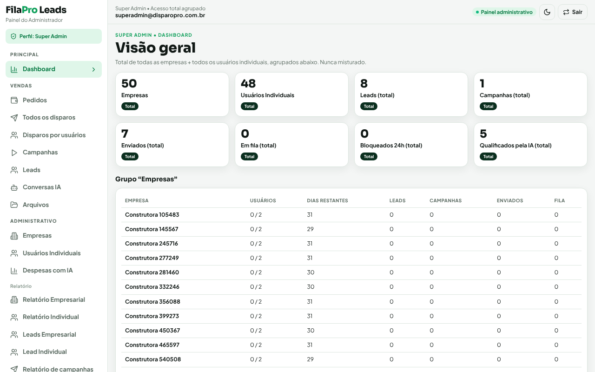

## Pedidos (vendas por PIX)

Toda compra feita no botão **Planos** da tela de login (ou renovação, ou WhatsApp extra) vira um pedido aqui, e você recebe um aviso no WhatsApp.

- Confira o PIX no seu banco (o **código do pedido** vai na identificação do PIX) e clique em **Confirmar pagamento**:
  - **compra nova:** a conta é criada e o acesso vai por e-mail;
  - **renovação:** o prazo é somado e o plano trocado, se mudou; os WhatsApps extras ficam como o cliente escolheu;
  - **WhatsApp extra:** o número é liberado na tela WhatsApp do cliente.
- **Cancelar** pedidos que não serão pagos. Pedidos vencidos (24 horas) também podem ser confirmados se o cliente pagou depois.

## Empresas

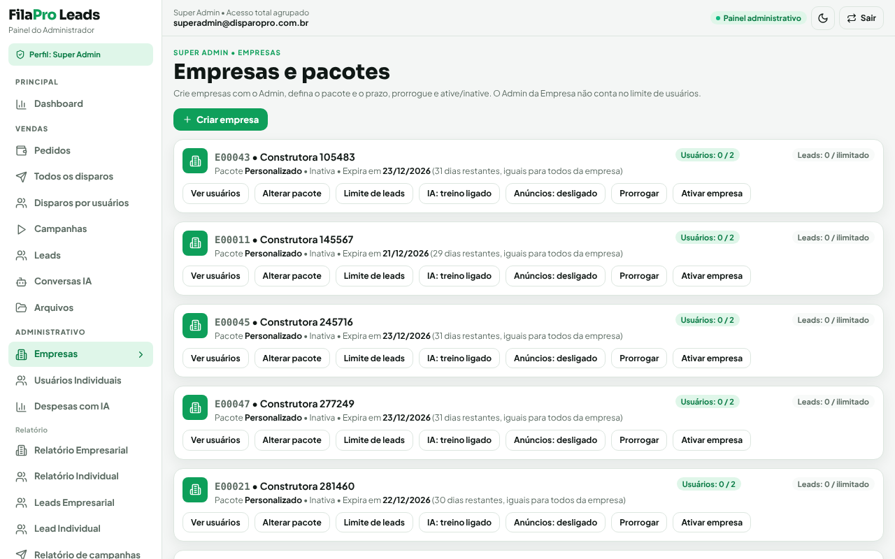

Para cada empresa: código, pacote, vencimento, usuários e leads. Ações:

- **Nova empresa** (sem pedido): nome, plano, Admin da Empresa.
- **Ver usuários**, **Alterar pacote** (quantidade de usuários), **Limite de leads** da empresa, **Prorrogar**, **Ativar/Inativar**.
- **IA: treino** — liga/desliga o treinamento da IA da conta, limites de materiais e de páginas por mês, e **Liberar agora**
  (zera o uso do mês/período).
- **Anúncios** — liga/desliga o recurso pago "Leads de anúncios" para a conta.

## Usuários Individuais

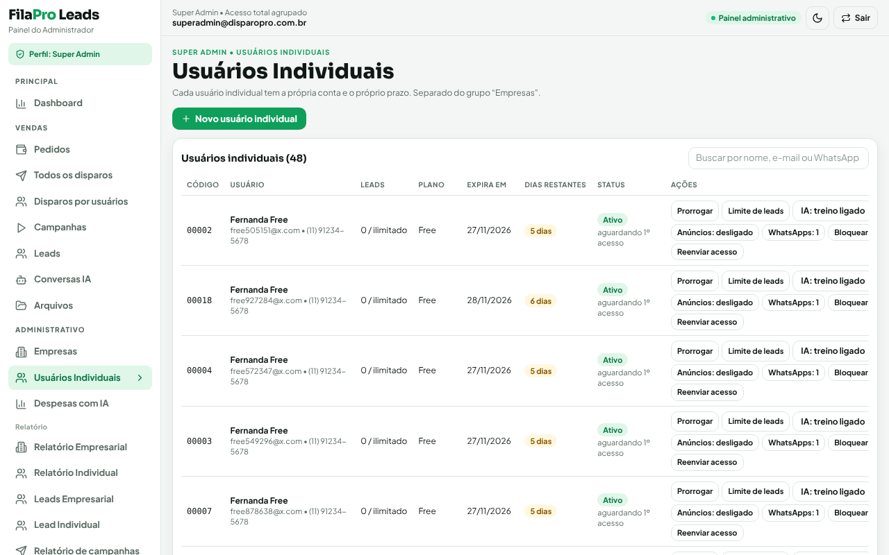

Cada usuário individual tem a própria conta e o próprio prazo. Ações: **Novo usuário**, **Prorrogar**, **Limite de leads**,
**Bloquear/Desbloquear**, **Reenviar acesso**, **IA: treino**, **Anúncios** e **WhatsApps** (números extras sem pedido;
ao diminuir, saem os mais recentes).

## Planos

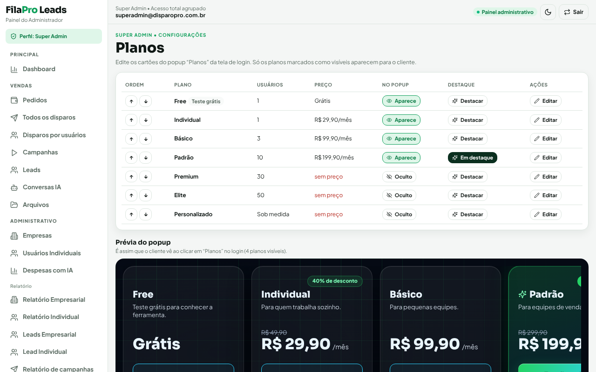

Os cartões do botão **Planos** da tela de login. Em cada plano:

- nome, preços (antigo riscado e atual), período, prazo, usuários, selo, frase, condições, oferta, recursos e texto do botão;
- **limite de leads**, **materiais da IA** e **páginas por mês** da IA;
- **Leads de anúncios incluído** (recurso pago);
- no plano Individual: **máximo de WhatsApps** e **preço do WhatsApp extra**;
- no Free: dias e disparos do teste grátis;
- **Visível** no login, **destaque** e ordem.

## Pagamento

Chave PIX e dados do recebedor (aparecem no PIX copia e cola dos pedidos) e o contato do plano Personalizado.

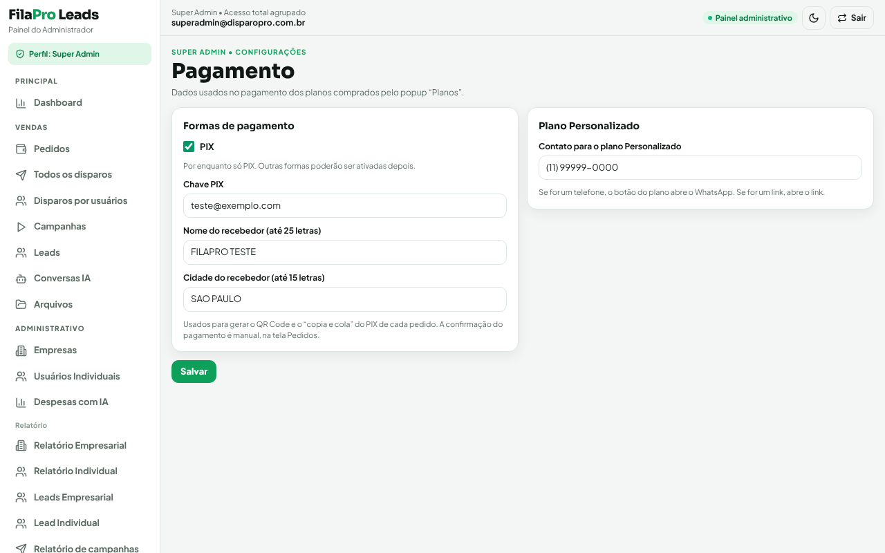

## Inteligência Artificial

- **Chave da Anthropic para todas as tarefas:** cole uma vez; vale para todas as tarefas do Claude. Para trocar de conta da
  Anthropic, é só colar a chave nova.
- **Cada tarefa** (gerar mensagens, aprender sobre a empresa, qualificar, conversar) pode usar outro provedor ou modelo, sem mexer no
  código. Padrão: **Claude Haiku 5.5**, o mais barato. Use **Testar** antes de salvar.
- **Cotação do dólar:** para a tela de despesas mostrar também em reais.

### Despesas com IA

Gráfico atualizado a cada 15 segundos (hoje, 7 dias, mês, período), em dólar e em reais, e o ranking das 30 empresas e
20 usuários individuais que mais consomem.

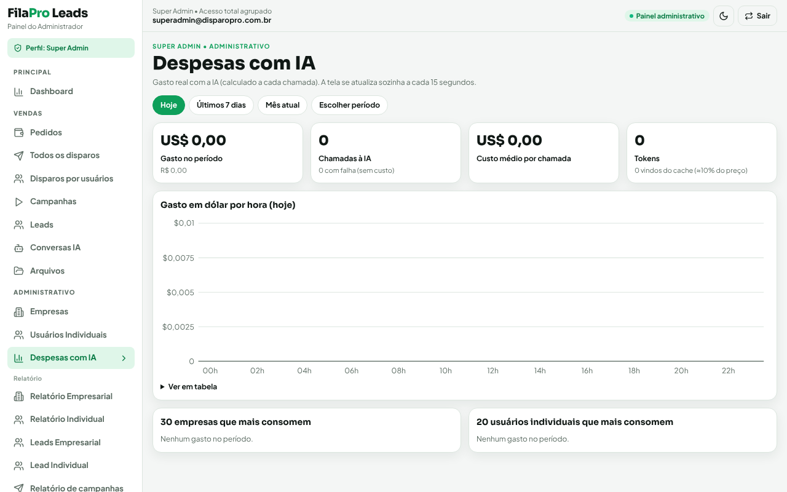

## Regras de envio

**Faixa global de horário** (nenhuma conta envia fora dela), **sua janela** (para as suas campanhas) e **feriados** (inclui a
Sexta-feira Santa, calculada a cada ano).

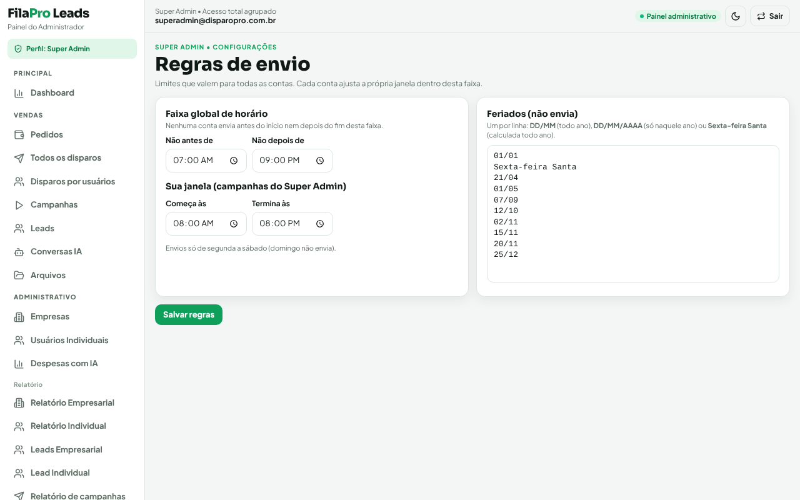

## Número da plataforma

O WhatsApp que envia os avisos do sistema. Use um número só para isso (de preferência um chip dedicado). Se ele cair, os avisos param
de sair, mas o restante do sistema continua.

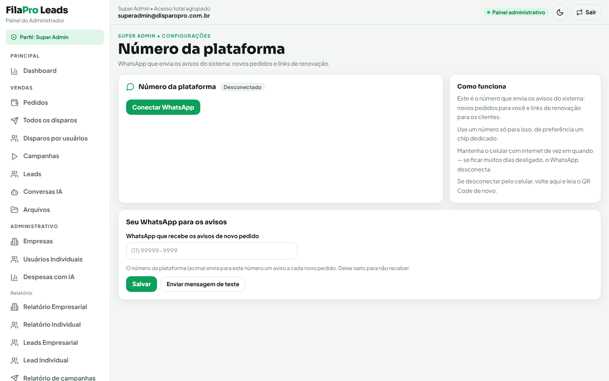

## Disparos e campanhas

- **Todos os disparos** e **Disparos por usuários:** acompanhe os envios de todas as contas.
- **Campanhas, Leads, Conversas IA, Arquivos, Empresa | IA, Meu WhatsApp, Avisos e Leads de anúncios:** as suas próprias, para enviar
  como um usuário (o Super Admin segue as mesmas regras do Antibloqueio). Em Leads e Conversas IA você também vê os das contas,
  agrupados, e responde só as suas.

## Relatórios

Menu **Relatório**: **Empresarial**, **Individual**, **Leads Empresarial**, **Lead Individual** e **Relatório de campanhas**.

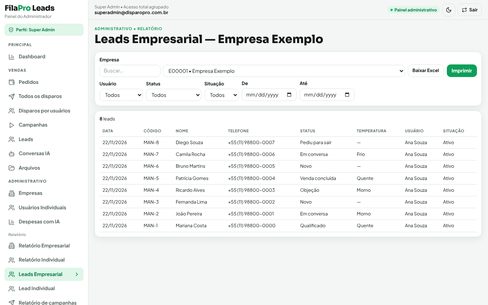

- Escolha a conta (com busca) e os filtros (usuário, status, situação, período).
- **Baixar Excel:** planilha com os filtros aplicados.
- **Imprimir:** todas as linhas, com cabeçalho (logo, nome do relatório, **quem emitiu**, data e total), quebra de página e
  **"Página X de Y"** — escolha "Salvar como PDF" na janela de impressão para gerar o PDF.

## Logs

O histórico dos últimos 90 dias de **todas as contas**: entradas, senhas erradas e bloqueios, usuários, leads, campanhas e WhatsApp,
com o IP. Filtre por conta, tipo e período.

## Logos

As 3 versões da logo, sem fundo, para baixar em **PNG** (alta resolução) ou **SVG**: letras vazadas (usada na impressão),
cores da marca e preto e branco.

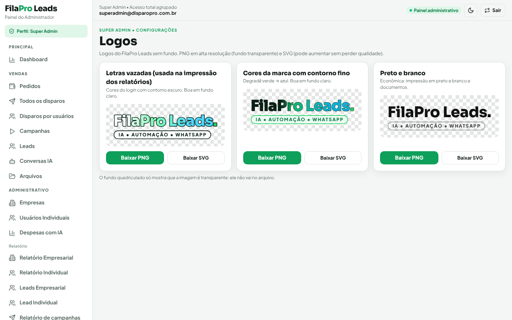

## Dados legais

Responsável, documento, endereço, e-mails e foro usados na **Política de Privacidade** e nos **Termos de Uso**
(filaproleads.com.br/privacidade e /termos). Campos vazios aparecem como "[a preencher pelo responsável]" nas páginas.

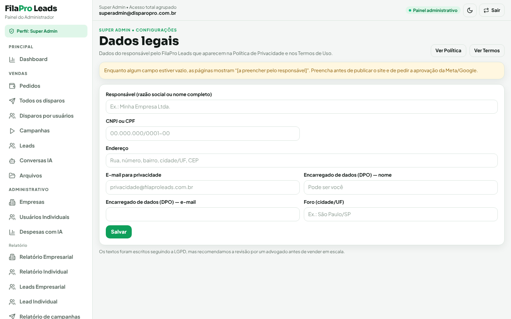

## Ajuda e versões

Menu **Ajuda**: todos os manuais (cada perfil vê o seu; o Super Admin vê todos) e **Novidades**, com o que mudou em cada versão.
A versão atual aparece no rodapé do menu e na tela de login (em teste). Todos os manuais podem ser impressos ou salvos em PDF.

## Operação do dia a dia

| O que | Como |
|---|---|
| Atualizar o sistema | Na VPS: `bash /opt/filapro/app/deploy/atualizar.sh` (faz backup antes e mostra a versão nova) |
| Voltar para a versão anterior | `bash /opt/filapro/app/deploy/voltar-versao.sh` |
| Backup do banco | Automático todo dia às 03:30 (Brasília), guardado por 14 dias em `/opt/filapro/backups` |
| Ver se está tudo no ar | `pm2 status` e https://api.filaproleads.com.br/saude |
| Mudar de servidor | Siga o Manual do Desenvolvedor, seção *Mudar de servidor* |

## Perguntas frequentes

**Um cliente pagou mas não recebeu o acesso.**
Confira em **Pedidos** se o pagamento foi confirmado e se o e-mail está certo; use **Reenviar acesso** em Usuários Individuais ou
peça ao Admin da Empresa para usar **Resetar senha**.

**A IA parou de responder em todas as contas.**
Veja em **Inteligência Artificial → Testar**. Normalmente é a chave ou o crédito da conta da Anthropic.

**Os avisos não chegam no WhatsApp.**
Confira se o **Número da plataforma** está conectado e use **Enviar mensagem de teste**.
