# Manual do Super Admin — FilaPro Leads

O Super Admin é o **dono da plataforma**: cria e cuida das contas (empresas e usuários individuais), dos planos e dos pagamentos,
configura a IA, as regras de envio e o número que envia os avisos, acompanha tudo pelos relatórios e logs — e também pode enviar
campanhas pelo próprio WhatsApp, como um usuário.

Para as funções de envio (leads, campanhas, Conversas IA, WhatsApp), veja também o **Manual do Usuário**. Para a parte técnica
(servidor, atualização, backup, código), veja o **Manual do Desenvolvedor**.

## Primeiro acesso e segurança

- O Super Admin é criado na instalação, com o e-mail definido no servidor (`SUPERADMIN_EMAIL`) e uma **senha temporária** (vale 7 dias).
- No primeiro acesso, crie a sua senha (pode usar **Gerar senha forte**).
- **Nunca** cole chaves ou senhas em conversas. As chaves de IA ficam guardadas **criptografadas** no menu Inteligência Artificial.
- Em produção não existem contas de demonstração nem os botões "Entrar como…" na tela de login.

## Primeiros passos depois de publicar

1. **Dados legais:** responsável, CPF/CNPJ, endereço, e-mail de privacidade, encarregado de dados (DPO) e foro. Aparecem na
   Política de Privacidade e nos Termos de Uso (páginas públicas).
2. **Pagamento:** chave PIX, nome e cidade do recebedor, e o contato do plano Personalizado.
3. **Planos:** preços, limites e o que cada plano inclui.
4. **Inteligência Artificial:** cole a chave da Anthropic e clique em **Testar** e **Salvar chave**.
5. **Número da plataforma:** conecte o WhatsApp que envia os avisos do sistema (pedidos, renovações, avisos aos usuários) e cadastre
   o seu WhatsApp para receber os avisos de novos pedidos.
   As mensagens saem em **fila**: 5 a 10 segundos entre uma e outra e até **200 por dia**. Pedidos, segurança e suporte nunca esperam o
   limite; avisos aos usuários e links de renovação esperam o dia seguinte se ele acabar. Com o número fora do ar, as mensagens ficam
   guardadas e saem na volta (expiram em 6 horas). A tela mostra "Enviadas hoje", "Na fila" e "Expiradas hoje".
   Se o número cair (3 minutos fora, na volta, 2 horas fora ou desconexão de vez), você recebe **notificação no celular e e-mail**
   e a tela mostra o selo vermelho **"Com problema"**.
6. **Regras de envio:** faixa global de horário e feriados.

## Dashboard

Totais da plataforma agrupados por empresa e por usuário individual: leads, enviados hoje, fila, bloqueados 24h, qualificados e a saúde dos números.

## Online

Quem está usando o sistema **agora** (ativo nos últimos 2 minutos), a **tela** aberta e o **aparelho** (Computador, Navegador do
celular ou App no celular). A tela atualiza sozinha a cada 20 segundos.

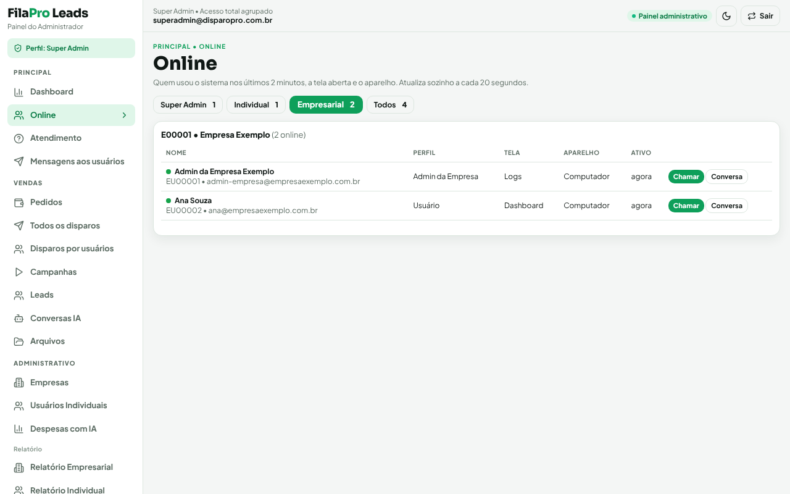

- Abas **Super Admin**, **Individual**, **Empresarial** (agrupado por empresa) e **Todos** (todas as contas, com busca e o
  **último acesso**).
- **Chamar:** abre o chat do suporte na tela do cliente. **Conversa:** abre o histórico em Atendimento.

## Chaves do WhatsApp

Uma vez por semana a tela **Logs** (tipo WhatsApp) mostra, para cada número, quantas chaves de criptografia ele guarda e o tamanho (por exemplo, "Chaves do WhatsApp (plataforma): 8.693 chaves, 0,8 MB; maior tipo: lid-mapping"). É só acompanhamento: nada é apagado. Se um número passar de 100 mil chaves ou 25 MB (ou o total de 150 MB), aparece "Atenção: chaves do WhatsApp … chegaram a …".

## Inteligência Artificial: atendimento em 4 pontos

No **Dashboard** há o quadro **Inteligência Artificial** com 4 pontos: **Leads**, **Campanhas**, **Suporte** e **Visitante não Cliente**.
🟢 verde = ligado e funcionando; 🟡 amarelo = ligado, mas com atenção (manutenção, falta de chave da IA ou falhas recentes);
🔴 vermelho = desligado. As chaves **Ligar / Desligar** ficam em **Inteligência Artificial → Atendimento por IA**. Ao religar um ponto, a IA
responde quem ficou esperando (últimas 48 horas). Você recebe aviso no WhatsApp de avisos e no celular quando um ponto fica amarelo, é desligado ou volta ao normal.

## Atendimento (suporte em tempo real)

Os clientes (Usuários e Admins da Empresa) chamam pelo botão **Suporte**. As conversas chegam aqui, com o número de mensagens novas
também no menu. A caixa de escrever e o cabeçalho da conversa ficam **fixos**: só a lista de mensagens rola.

**Encerramento por inatividade:** 10 minutos depois da sua resposta (ou da resposta da IA), se o cliente não escrever, o atendimento é encerrado com um aviso no chat e o selo "Encerrada" na lista; quando o cliente escrever de novo, reabre sozinho. Nunca encerra enquanto o cliente espera você.

**IA no suporte dos clientes:** no topo de Atendimento → Clientes há a chave **Ligar a IA** (começa desligada). Ligada, a IA responde primeiro, com o
manual do perfil do cliente e os dados da conta dele. Quando você escreve, ela para naquela conversa; **Devolver para a IA** a reativa.
Para ensinar a IA do suporte, use **Configurações → Empresa | IA → Orientações do suporte** (horário, respostas prontas, regras de atendimento) e teste com **Testar uma pergunta**.
Pagamento, cobrança, cancelamento, conta bloqueada, reclamação, arquivos, pedido de atendente e dúvidas que ela não souber passam para você,
com aviso no WhatsApp de avisos e no celular. Limite de 20 respostas da IA por conversa por dia; o custo aparece em Despesas com IA.

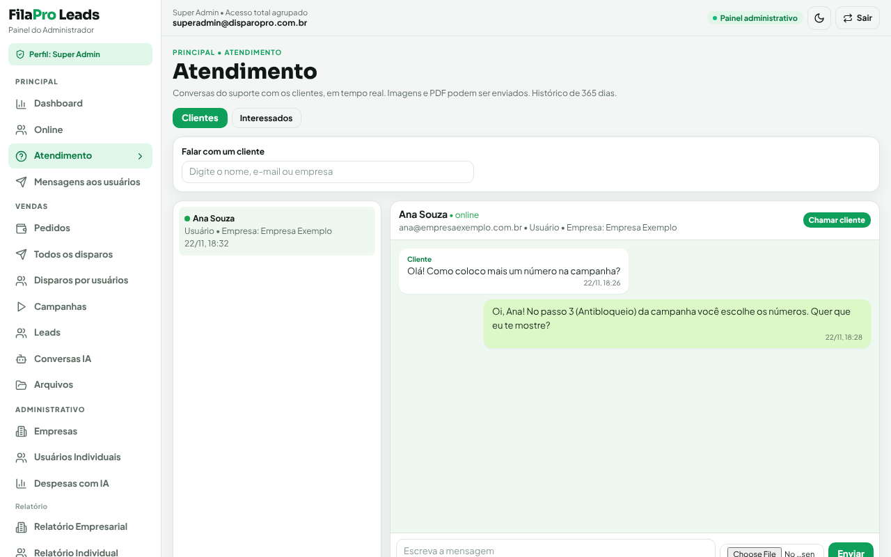

- Escolha a conversa à esquerda e responda; pode anexar **imagem (JPG/PNG) ou PDF** até 15 MB.
- **Falar com um cliente:** busque qualquer cliente e abra a conversa. **Chamar cliente:** o chat abre sozinho na tela dele e chega
  uma notificação no celular (se ele ativou).
- Se nenhum Super Admin estiver online quando um cliente escrever, você recebe um aviso no **WhatsApp de avisos** (cadastrado em
  Número da plataforma) e no celular.
- Histórico de 365 dias. O Admin da Empresa não vê as conversas dos usuários com o suporte.

### Aba Interessados (quem ainda não é cliente)

Na tela de **Planos** (botão Planos do login) há o botão **💬 Fale conosco**. O visitante informa nome, WhatsApp (e e-mail, se
quiser), aceita a Política de Privacidade e conversa — só por texto.

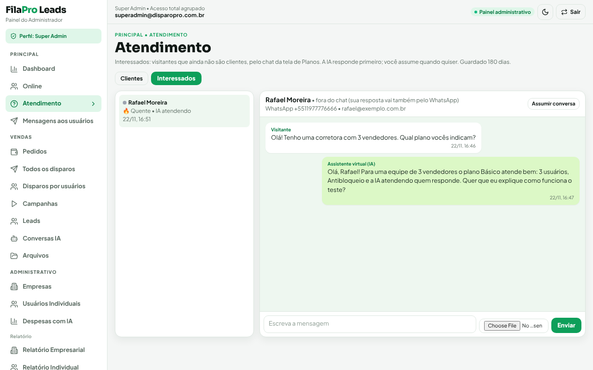

- **A IA responde primeiro**, como vendedora do FilaPro Leads, usando o **seu Empresa | IA** e os **planos visíveis**, e marca o
  interessado como Quente, Morno ou Frio.
- Se a IA não souber responder, ela **pausa** e você recebe aviso no WhatsApp e no celular.
- **Assumir conversa** (ou escrever uma mensagem) faz a IA parar; **Devolver para a IA** faz ela voltar. Você pode enviar imagem ou PDF.
- Se o visitante não estiver com o chat aberto, a sua resposta vai **também pelo WhatsApp** dele (pelo Número da plataforma).
- A conversa continua no mesmo aparelho do visitante por 30 dias. Se ele comprar (mesmo e-mail ou WhatsApp), a conversa vira o
  **suporte do novo cliente** (aba Clientes). Quem não compra fica guardado 180 dias.
- Proteção contra robôs: limite de mensagens por minuto.

## Mensagens aos usuários

Avisos que aparecem **em popup no centro da tela** do usuário e só fecham com **OK**. Quem estiver fora do sistema vê no próximo acesso.
Não vai cópia por WhatsApp nem e-mail.

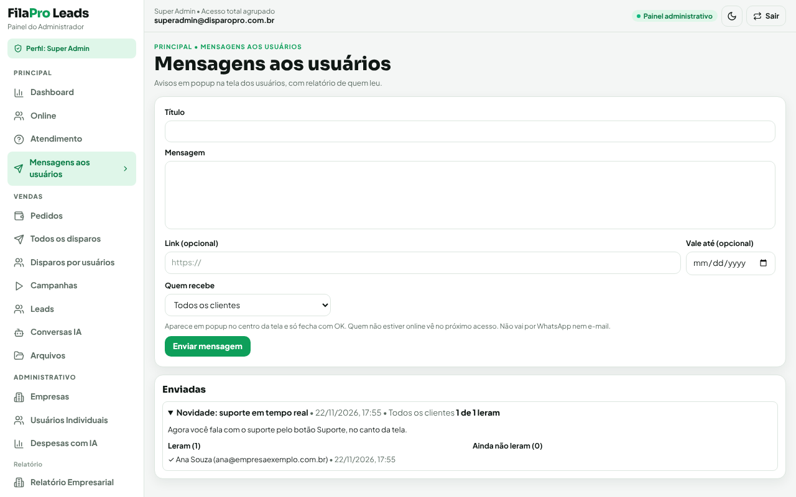

- **Título**, **mensagem**, **link** (opcional, começando com https://) e **vale até** (opcional — depois da data, não aparece mais
  para quem ainda não viu).
- **Quem recebe:** todos os clientes, Admins das empresas, usuários das empresas, usuários individuais, todos de uma empresa ou
  usuários escolhidos um a um.
- **Enviadas:** quantos leram de cada mensagem; abra para ver **quem leu** (com data e hora) e quem ainda não leu.

## Pedidos

Toda compra feita no botão **Planos** da tela de login (ou renovação, WhatsApp extra, pacote de disparos) vira um pedido aqui,
e você recebe um aviso no WhatsApp. Abaixo do valor aparece a **forma de pagamento**: PIX manual, PIX (Asaas), Boleto ou Cartão
(com o número de parcelas). Cancelar um pedido do Asaas apaga a cobrança lá também.

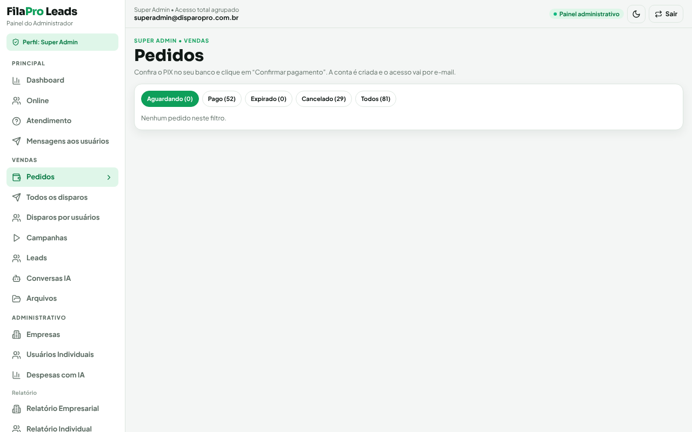

- Pedidos pagos pelo **Asaas** se confirmam sozinhos (veja *Pagamento → Asaas*). No **PIX manual**, confira o PIX no seu banco
  (o **código do pedido** vai na identificação do PIX) e clique em **Confirmar pagamento**:
  - **compra nova:** a conta é criada e o acesso vai por e-mail;
  - **renovação:** o prazo é somado e o plano trocado, se mudou; os WhatsApps extras ficam como o cliente escolheu;
  - **WhatsApp extra:** o número é liberado na tela WhatsApp do cliente;
  - **disparos extras:** o saldo do período da conta aumenta e as campanhas pausadas por falta de saldo voltam sozinhas.
- **Cancelar** pedidos que não serão pagos. Pedidos vencidos (24 horas) também podem ser confirmados se o cliente pagou depois.

## Empresas

Para cada empresa: código, pacote, vencimento, usuários e leads. Ações:

- **Nova empresa** (sem pedido): nome, plano, Admin da Empresa.
- **Ver usuários**, **Alterar pacote** (plano e quantidade de pacotes — ex.: Padrão 10 a 50 usuários; disparos e leads acompanham), **Limite de leads** da empresa, **Prorrogar**, **Ativar/Inativar**.
- **IA: treino** — liga/desliga o treinamento da IA da conta, limites de materiais e de páginas por mês, e **Liberar agora**
  (zera o uso do mês/período).
- **Anúncios** — liga/desliga o recurso pago "Leads de anúncios" para a conta.

## Usuários Individuais

Cada usuário individual tem a própria conta e o próprio prazo. Em **Novo usuário individual**, escolha o **Tipo**
(**Mensal** — por dias, sem limite de disparos — ou **Por disparo**) e depois o plano daquele tipo; o limite de disparos da conta
vem do plano (no Free, dos disparos do teste). Ações: **Novo usuário**, **Prorrogar**, **Limite de leads**,
**Bloquear/Desbloquear**, **Reenviar acesso**, **IA: treino**, **Anúncios** e **WhatsApps** (números extras sem pedido;
ao diminuir, saem os mais recentes).

## Financeiro (faturamento e despesas)

Grupo **Financeiro** do menu, só para o Super Admin. Tudo em **regime de caixa**: receitas e despesas contam no dia em que foram pagas.

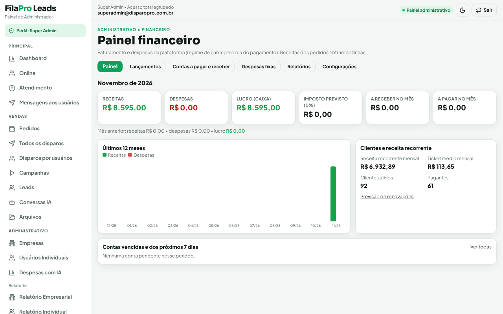

- **Painel:** receitas, despesas, lucro, **imposto previsto**, a receber e a pagar do mês; o mês anterior; gráfico de 12 meses;
  receita recorrente mensal, ticket médio, clientes ativos e pagantes; contas vencidas e dos próximos 7 dias.
- **O que entra sozinho:**
  - todo **pedido confirmado** vira receita paga (venda, renovação, WhatsApp extra ou pacote de disparos) — os antigos também;
  - as **despesas fixas** do mês (como pendentes);
  - no dia 1, a **despesa com IA** do mês anterior (dólar × cotação cadastrada em Inteligência Artificial).
- **Lançamentos:** receitas e despesas com filtros (período, tipo, categoria, conta, situação). **+ Novo lançamento** (pago ou
  pendente, com comprovante PDF/imagem opcional). Em cada linha: **Pagar/Receber**, **Anexar** comprovante, **Estornar** (receitas)
  e **Cancelar**.
- **Estorno:** devolve todo ou parte do valor de uma receita, ligado ao pedido, e abate do faturamento. Receita de pedido não se
  cancela — se estorna.
- **Contas a pagar e receber:** pendentes em Vencidas, Próximos 7 dias e Depois. Você recebe **aviso no WhatsApp e no celular**
  das vencidas e das que vencem em até 3 dias (1 vez por dia).
- **Despesas fixas:** descrição, valor, dia do vencimento, categoria e conta; **Pausar** quando acabar.
- **Relatórios:** resultado por mês, fluxo de caixa, faturamento por plano, receitas e despesas por categoria, receita recorrente e
  clientes ativos, cancelamentos (quem não renovou) e previsão de renovações (30/60/90 dias) — com **Baixar Excel** e **Imprimir**.
- **Configurações:** alíquota do **imposto previsto** (% sobre o recebido no mês, ex.: Simples Nacional), categorias (prontas e
  as suas) e contas bancárias.

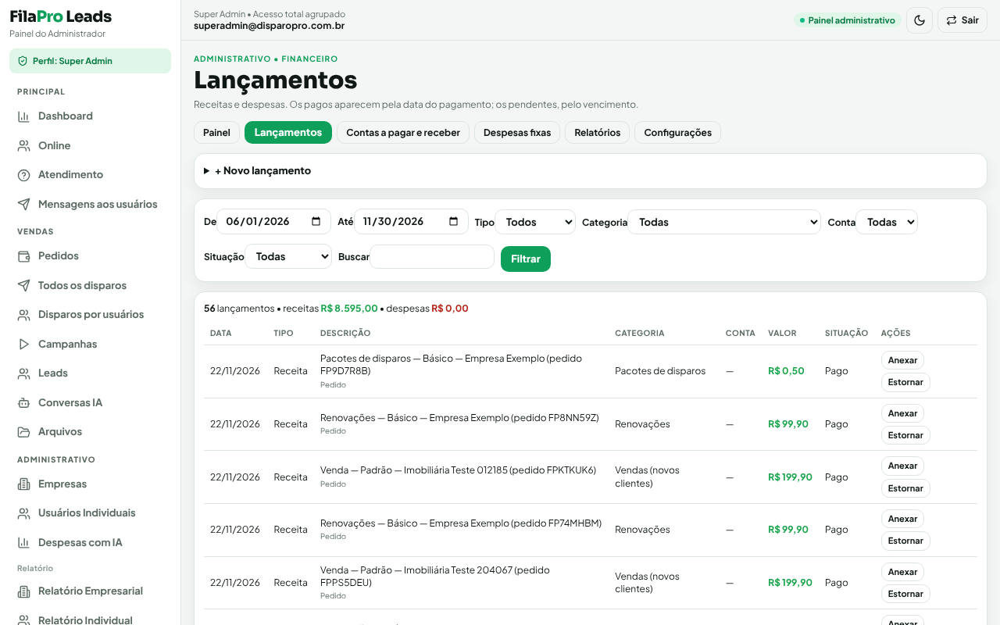

## Planos

**Abas do popup (decisões #111 e #113):** primeiro **Individual | Empresarial** e, em cada um, **Mensal** (sem limite de disparos) e
**Por disparo**. A aba é automática: com **Disparos por período** preenchido o plano vai para *Por disparo*; vazio, para *Mensal*.
O **Free** com *disparos do teste* vai para *Por disparo*; sem, para *Mensal* (teste por dias). Cada aba tem o **seu destaque**.

**Preço por quantidade (decisão #113):** o cliente escolhe a quantidade no cartão e o preço muda na hora:
valor do plano + cada item a mais com o desconto da posição (**Desconto do 2º, 3º, 4º e 5º**, ajustáveis em cada plano).
O editor mostra a tabela de preços ao vivo.
- **Individual:** **máximo de números** (até 4: o principal + 3).
- **Empresarial:** **máximo de pacotes** (ex.: Padrão 10 usuários × até 5 = 50). Disparos por período e limite de leads multiplicam
  pelos pacotes; materiais da IA e o pacote extra de disparos, não.

- **+ Novo plano:** nome e módulo; nasce **oculto**. Depois, **Editar** para completar.
- **Duplicar:** cópia oculta (bom para criar a versão "por quantidade" de um plano).
- **Excluir:** só plano sem pedidos e sem contas usando; senão, use **Oculto**.
- Plano pago com preço **R$ 0,00** (ou sem preço) aparece como **"Em breve"**: o visitante vê o plano, mas não consegue comprar.
  Coloque o preço e ele passa a vender na hora. Pacote extra com preço zero também não é vendido.

**Duas formas de vender:** só por **prazo** (sem limite de envios) ou por **prazo + quantidade de disparos por período**. Na segunda:

- contam só as mensagens de campanha **enviadas com sucesso**; as respostas da IA não contam;
- acabou o saldo: as campanhas **pausam e o cliente é avisado**; a IA continua atendendo;
- o cliente dono da conta (Individual ou Admin da Empresa) compra **pacotes extras** pelo Dashboard, por PIX; você confirma em Pedidos;
- no Empresarial o saldo é da empresa inteira; tudo **zera na renovação**.

Os cartões do botão **Planos** da tela de login. Em cada plano:

- nome, preços (antigo riscado e atual), período, prazo, usuários, selo, frase, condições, oferta, recursos e texto do botão;
- **limite de leads**, **materiais da IA** e **páginas por mês** da IA;
- **Leads de anúncios incluído** (recurso pago);
- **descontos por posição** e, no Individual, **máximo de números**; no Empresarial, **máximo de pacotes**;
- **disparos por período** (em branco = vendido só por prazo, sem quantidade), **disparos por pacote extra** e **preço do pacote**;
- no Free: dias e disparos do teste grátis;
- **Visível** no login, **destaque** e ordem.

## Pagamento

Chave PIX e dados do recebedor (aparecem no PIX copia e cola dos pedidos) e o contato do plano Personalizado.

**Asaas (decisão #115)** — cartão, PIX com confirmação automática e boleto:

1. Crie a conta no Asaas (asaas.com). Para testar sem cobrar ninguém, crie também a conta de testes em sandbox.asaas.com.
2. No Asaas: **Integrações → Chaves de API → Gerar chave**. Copie a chave (ela não aparece de novo no Asaas).
3. Aqui em **Pagamento → Asaas**: escolha o **Ambiente** (Testes ou Produção), cole a chave e clique **Salvar e testar conexão**.
   A chave só é guardada se o Asaas aceitar; fica criptografada e não aparece de novo na tela.
   Chave de testes começa com `$aact_hmlg_`, de produção com `$aact_prod_` — o sistema avisa se não combinar com o ambiente.
4. Clique **Configurar aviso automaticamente**: o FilaPro cadastra sozinho o aviso (webhook) no Asaas, com o token, os eventos
   de cobrança e a fila liberada. **Verificar no Asaas** mostra se o aviso existe, está ativo ou com a fila pausada.
   O quadro **Último aviso recebido** mostra quando chegou o último aviso do Asaas; "Aviso recusado" = token diferente
   (clique em Configurar de novo). Quem preferir pode cadastrar à mão (em "Prefere cadastrar à mão no Asaas?").
   Ao trocar de ambiente (Testes → Produção), clique em Configurar de novo.
5. Nunca mande a chave por chat, e-mail ou WhatsApp. Se vazar, gere outra no Asaas e cole aqui.

**Com o Asaas conectado, o cliente escolhe a forma de pagamento** (compra, renovação):

- **PIX** (aprovação na hora), **Cartão** (na página segura do Asaas — o FilaPro não vê o cartão) ou **Boleto** (+2%, compensa em 1 a 3 dias úteis);
- o cliente informa o **CPF ou CNPJ** de quem paga (o Asaas exige); fica guardado na conta e as próximas compras usam o mesmo;
- **Parcelamento no cartão:** planos **trimestrais e anuais**, até **6x**, com os **juros ao mês** que você define no quadro
  *Parcelamento no cartão* (vazio = só à vista; 0 = sem juros). O cliente vê o valor de cada parcela antes de pagar;
- WhatsApp extra e pacotes de disparos: PIX do Asaas;
- o **PIX manual** (chave acima) fica como **reserva**: só é usado com o Asaas desligado.

**Confirmação automática (decisão #117):** com o aviso configurado, o pedido se confirma sozinho — sem clicar em nada:

- **PIX e boleto:** quando o dinheiro cai no Asaas; **cartão:** quando a compra é aprovada (parcelado: na 1ª parcela aprovada);
- acontece o mesmo que no botão **Confirmar pagamento** (conta criada, renovação, extras liberados, e-mail ao cliente);
  em Pedidos, "confirmado por" mostra **Asaas**;
- a **taxa do Asaas** (valor cobrado − valor recebido) entra no Financeiro como despesa paga, na categoria **Taxas do Asaas**
  (uma por cobrança; no cartão parcelado, uma por parcela);
- **estorno** no Asaas: o estorno entra no Financeiro (abatendo a venda) e a **empresa é inativada** (vale também para WhatsApp
  extra e pacote de disparos). Você recebe um aviso; para liberar de novo, use **Empresas**;
- **contestação no cartão** (chargeback): você só é avisado; a conta só é bloqueada se o estorno acontecer;
- **pagamento de um pedido cancelado:** o pedido **não** é confirmado — você recebe um aviso e decide em Pedidos;
- se o pedido não puder ser confirmado sozinho (ex.: o e-mail já tem acesso), você também é avisado.

Os avisos chegam no WhatsApp de avisos e no celular, e ficam em **Logs** (tipo *Pagamentos (Asaas)*). Se um aviso do Asaas falhar
no processamento, o FilaPro tenta de novo no próximo aviso e na rotina diária. O botão **Confirmar pagamento** continua valendo
para o PIX manual e para conferir à mão se algum aviso não chegar.

**Cobrança automática no cartão (decisão #124):** na compra e na renovação, ao escolher **Cartão**, a opção **Cobrar automaticamente
a cada período** vem marcada (só planos mensais, trimestrais, semestrais e anuais; sempre à vista). O FilaPro cria uma **assinatura**
no Asaas: o cliente paga a 1ª vez na página do Asaas (o cartão fica guardado lá) e, a cada período, o Asaas cobra sozinho no dia do
vencimento — o FilaPro cria e confirma o pedido de renovação (em Pedidos: **Cartão (automática)**), soma o prazo e lança a receita
e a taxa. Mudou o plano, a quantidade ou o vencimento (inclusive **Alterar pacote** e **Prorrogar**): o valor e a data da assinatura
acompanham. Plano sem período fixo: a cobrança automática é desligada e o dono recebe um e-mail. Em **Empresas** e em **Usuários
Individuais** aparece **Cobrança automática: ligada** e o botão **Desligar cobrança automática**. Quem tem cobrança automática
recebe um aviso só, 3 dias antes ("será renovado automaticamente"), sem o link de renovação.

## Inteligência Artificial

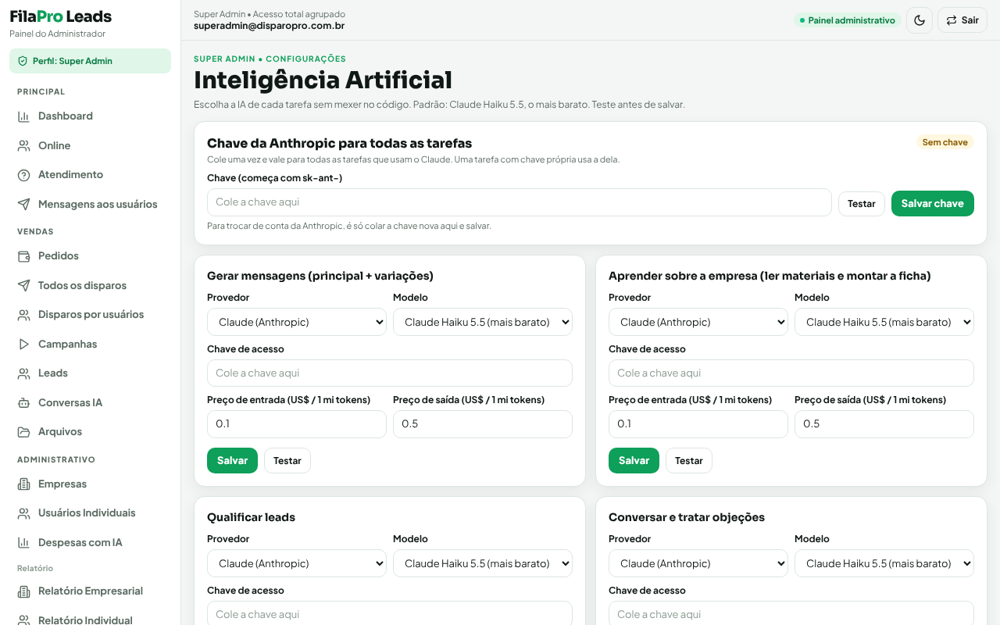

- **Chave da Anthropic para todas as tarefas:** cole uma vez; vale para todas as tarefas do Claude. Para trocar de conta da
  Anthropic, é só colar a chave nova.
- **Cada tarefa** (gerar mensagens, aprender sobre a empresa, qualificar, conversar) pode usar outro provedor ou modelo, sem mexer no
  código. Padrão: **Claude Haiku 5.5**, o mais barato. Use **Testar** antes de salvar.
- **Cotação do dólar:** para a tela de despesas mostrar também em reais.
- **Texto sugestão do "Como qualificar os leads":** o roteiro que aparece no botão **Texto sugestão** do Empresa | IA de todos os
  clientes. Clique no campo para editar e **Salvar**; **Voltar ao texto padrão** desfaz. Deixe os textos entre colchetes [ ] para o
  cliente trocar. Quem já salvou o próprio texto no Empresa | IA não muda.

### Despesas com IA

Gráfico atualizado a cada 15 segundos (hoje, 7 dias, mês, período), em dólar e em reais, e o ranking das 30 empresas e
20 usuários individuais que mais consomem.

## Regras de envio

**Faixa global de horário** (nenhuma conta envia fora dela), **sua janela** (para as suas campanhas) e **feriados** (inclui a
Sexta-feira Santa, calculada a cada ano).

## Número da plataforma

O WhatsApp que envia os avisos do sistema. Use um número só para isso (de preferência um chip dedicado). Se ele cair, os avisos param
de sair, mas o restante do sistema continua.

## Disparos e campanhas

- **Todos os disparos** e **Disparos por usuários:** acompanhe os envios de todas as contas.
- **Meu WhatsApp:** até **10 números**, sem pagamento (**Adicionar mais um WhatsApp** / **Remover o último número**).
- **Campanhas, Leads, Conversas IA, Arquivos, Empresa | IA, Meu WhatsApp, Avisos e Leads de anúncios:** as suas próprias, para enviar
  como um usuário (o Super Admin segue as mesmas regras do Antibloqueio). Em Leads e Conversas IA você também vê os das contas,
  agrupados, e responde só as suas.

## Relatórios

Menu **Relatório**: **Empresarial**, **Individual**, **Leads Empresarial**, **Lead Individual** e **Relatório de campanhas**.

- Escolha a conta (com busca) e os filtros (usuário, status, situação, período).
- **Baixar Excel:** planilha com os filtros aplicados.
- **Imprimir:** todas as linhas, com cabeçalho (logo, nome do relatório, **quem emitiu**, data e total), quebra de página e
  **"Página X de Y"** — escolha "Salvar como PDF" na janela de impressão para gerar o PDF.

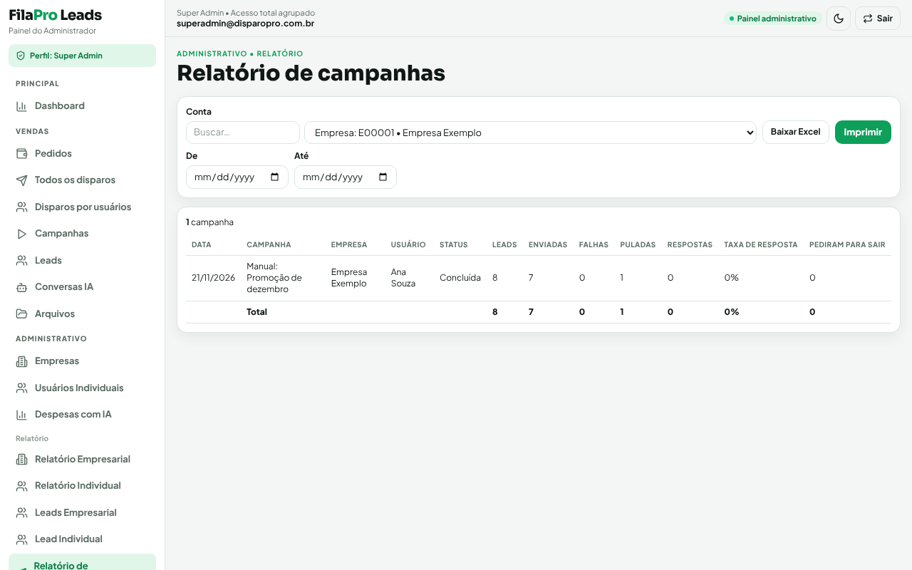

## Logs

O histórico dos últimos 90 dias de **todas as contas**: entradas, senhas erradas e bloqueios, usuários, leads, campanhas e WhatsApp,
com o IP. Filtre por conta, tipo e período.

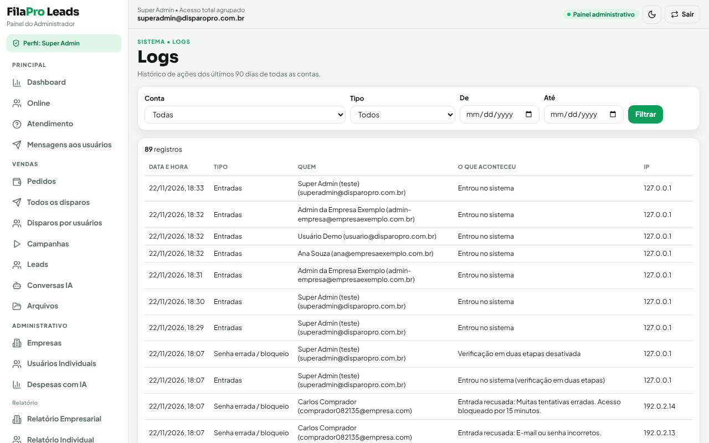

## Logos

As 3 versões da logo, sem fundo, para baixar em **PNG** (alta resolução) ou **SVG**: letras vazadas (usada na impressão),
cores da marca e preto e branco.

## Dados legais

Responsável, documento, endereço, e-mails e foro usados na **Política de Privacidade** e nos **Termos de Uso**
(filaproleads.com.br/privacidade e /termos). Campos vazios aparecem como "[a preencher pelo responsável]" nas páginas.

## Ajuda e versões

Menu **Ajuda**: todos os manuais (cada perfil vê o seu; o Super Admin vê todos) e **Novidades**, com o que mudou em cada versão.
A versão atual aparece no rodapé do menu e na tela de login (em teste). Todos os manuais podem ser impressos ou salvos em PDF.

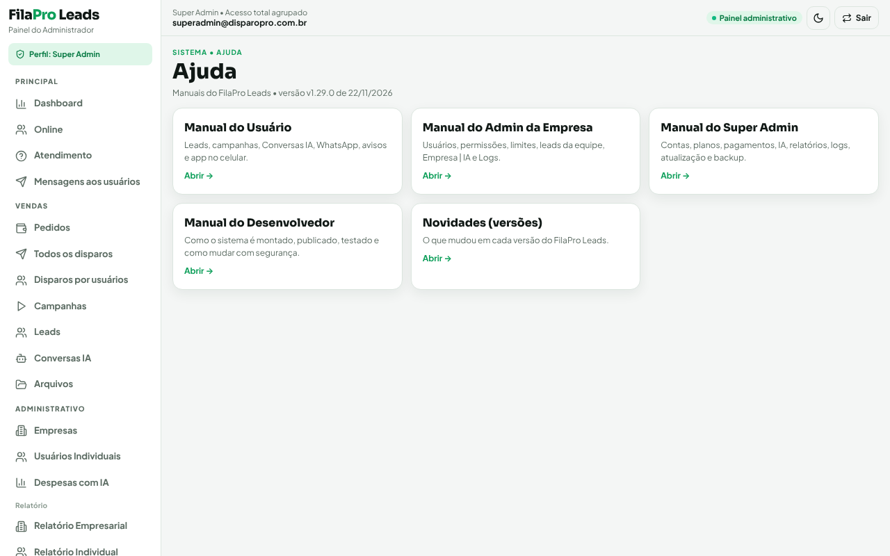

## Operação do dia a dia

| O que | Como |
|---|---|
| Atualizar o sistema | Na VPS: `bash /opt/filapro/app/deploy/atualizar.sh` (faz backup, liga o **modo manutenção**, atualiza, libera e mostra a versão nova) |
| Avisar os usuários antes | `bash /opt/filapro/app/deploy/atualizar.sh --aviso 10` (mensagem em popup e espera 10 minutos) |
| Modo manutenção à mão | `bash /opt/filapro/app/deploy/manutencao.sh ligar` / `desligar` / `estado` — ou **Liberar o sistema** na faixa laranja do sistema |
| Voltar para a versão anterior | `bash /opt/filapro/app/deploy/voltar-versao.sh` |
| Backup do banco | Automático todo dia às 03:30 (Brasília), guardado por 14 dias em `/opt/filapro/backups` |
| Ver se está tudo no ar | `pm2 status` e https://api.filaproleads.com.br/saude |
| Mudar de servidor | Siga o Manual do Desenvolvedor, seção *Mudar de servidor* |
| Proteger a VPS (uma vez) | `bash /opt/filapro/app/deploy/seguranca-vps.sh` — SSH só com chave, fail2ban e atualizações de segurança automáticas |

## Segurança (verificação em duas etapas)

Menu **Segurança**: além da senha, a entrada passa a pedir o **código de 6 dígitos** do app autenticador do seu celular
(Google Authenticator, Microsoft Authenticator ou Authy). **Recomendado ativar.**

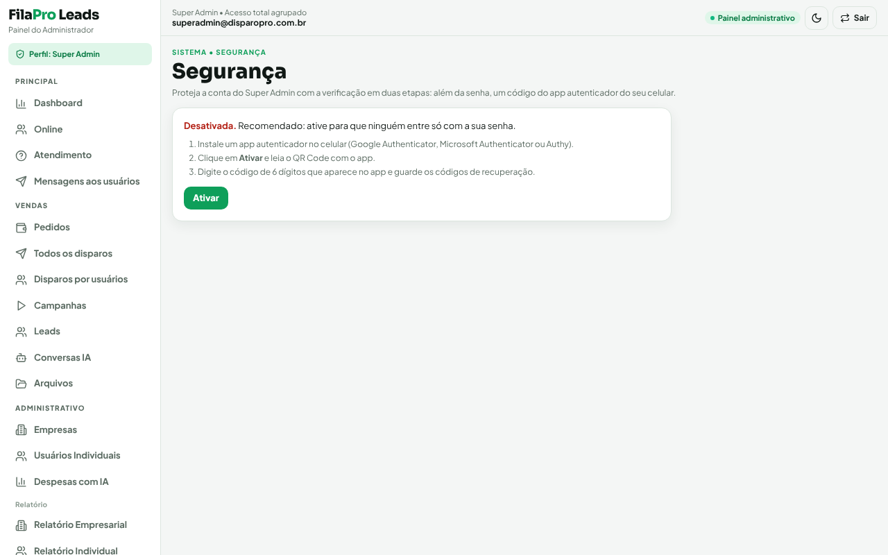

1. Instale o app autenticador → clique em **Ativar** → leia o QR Code com o app.
2. Digite o código do app em **Confirmar e ativar**.
3. Guarde os **10 códigos de recuperação** (fora do celular). Cada um permite entrar uma vez se você perder o celular.

Depois de ativada: senha → tela do código. **Cada código do app vale uma vez** (se entrar duas vezes em menos de 30 segundos, espere o próximo
código). 5 códigos errados cancelam a tentativa (é preciso digitar a senha de novo); **10 códigos errados em 15 minutos congelam a verificação
por código por 15 minutos** e você recebe um alerta — os **códigos de recuperação continuam funcionando**. Para desativar ou gerar novos
códigos de recuperação, informe o código atual do app. Esqueci minha senha **não dispensa** a verificação em duas etapas.

**Alertas de segurança** (no WhatsApp de avisos e no celular): a conta do Super Admin bloqueada por senha errada, 3 ou mais contas
bloqueadas na plataforma em 1 hora e entrada do Super Admin por um endereço de internet novo.

**Proteções automáticas:** limite de tentativas por endereço de internet (login, Esqueci minha senha, compra, teste grátis, renovação,
leads de anúncios e chat; endereços IPv6 contam pelo bloco), o sistema não pode ser aberto dentro de outro site e o navegador só carrega
arquivos do próprio sistema. **Senhas erradas:** 5 erros bloqueiam só o endereço de quem errou (15 minutos); 30 erros de vários endereços
colocam a conta em proteção (o dono recebe um e-mail). **Recuperação de senha:** link de uso único (30 minutos) enviado ao e-mail, no máximo
3 pedidos por hora e 10 minutos entre links; contas vencidas, inativas ou bloqueadas não têm acesso a arquivos, relatórios nem rotas do sistema.

## Status no login

A pílula embaixo dos destaques do login mostra o estado real, para qualquer visitante:

- **Verde — Sistema Online:** site e serviço 24/7 respondendo. **Amarelo — Em atualização:** modo manutenção ligado.
  **Vermelho — Instabilidade:** o serviço 24/7 não responde (veja `pm2 list` na VPS).
- **Fila (com a própria bolinha):** 🟢 Fila Ativa; 🟡 Fila pausada ou Em manutenção; 🔴 Fila parada.
- **Uptime:** porcentagem dos últimos 30 dias em que o serviço 24/7 esteve no ar (medida a cada minuto; aparece depois de 1 hora).

Também dá para consultar sem abrir o site: **https://filaproleads.com.br/api/status**.

## Modo manutenção (atualizações)

Durante a atualização os clientes veem **"Sistema em atualização"** e o servidor não aceita nenhuma ação; campanhas, respostas da IA e
leads de anúncios ficam em espera e continuam depois. **Você continua entrando** (no login, clique em "Sou Super Admin — entrar para
conferir") e vê uma faixa laranja com **Liberar o sistema**. Se a atualização der erro, o sistema **fica em manutenção** até você
voltar a versão (`voltar-versao.sh`) ou liberar.

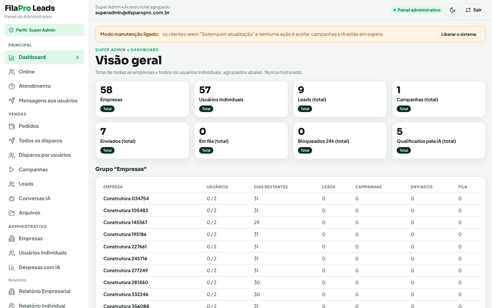

## Perguntas frequentes

**Um cliente pagou mas não recebeu o acesso.**
Confira em **Pedidos** se o pagamento foi confirmado e se o e-mail está certo; use **Reenviar acesso** em Usuários Individuais ou
peça ao Admin da Empresa para usar **Resetar senha**.

**A IA parou de responder em todas as contas.**
Veja em **Inteligência Artificial → Testar**. Normalmente é a chave ou o crédito da conta da Anthropic.

**Os avisos não chegam no WhatsApp.**
Confira se o **Número da plataforma** está conectado e use **Enviar mensagem de teste**.
