# Manual do Usuário — FilaPro Leads

Este manual é para quem **envia as mensagens**: o usuário do plano **Individual** e o usuário de uma **empresa**.
O FilaPro Leads envia campanhas pelo **seu próprio WhatsApp**, com proteção contra bloqueio, e a **IA atende quem responde**,
qualifica os leads (Quente, Morno, Frio) e trata objeções.

> No plano Empresarial, o administrador da empresa decide quais telas você vê. Se faltar algum menu descrito aqui,
> fale com ele.

## Primeiro acesso

1. Você recebe por e-mail uma **senha temporária**.
2. Abra **filaproleads.com.br**, escolha **Módulo Individual** ou **Módulo Empresarial** e entre com o e-mail e a senha temporária.
3. Crie a sua senha definitiva: no mínimo 12 caracteres, com maiúscula, minúscula, número e caractere especial.
   Se preferir, clique em **Gerar senha forte** e depois em **Copiar senha** — guarde-a antes de salvar.
4. Esqueceu a senha? Na tela de login, clique em **Esqueci minha senha**: uma nova senha temporária chega no seu e-mail.

Depois de 5 senhas erradas seguidas, o acesso fica bloqueado por 15 minutos.

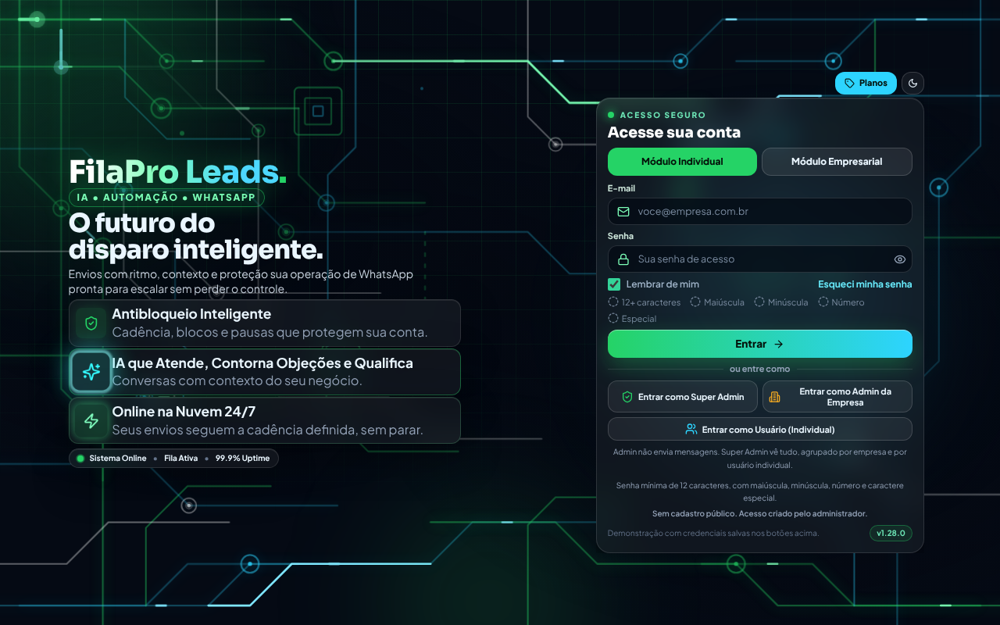

## Dashboard

A primeira tela mostra os seus números: leads, enviados hoje, fila, bloqueados nas últimas 24 horas e leads qualificados pela IA,
além da **saúde do seu número** (Boa, Atenção ou Ruim, nos últimos 7 dias).

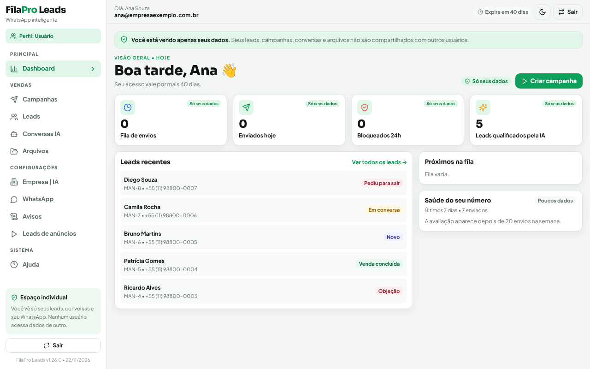

### Disparos do período

Se o seu plano tem uma **quantidade de disparos por período**, o Dashboard mostra quantos você já usou e quantos restam:

- só contam as mensagens de campanha **enviadas com sucesso** (as respostas da IA e as suas mensagens nas Conversas IA não contam);
- quando o saldo acaba, as campanhas **pausam e você é avisado** — a IA continua atendendo quem responde;
- no plano **Individual**, você pode **comprar um pacote extra** ali mesmo (pagamento por PIX). Assim que o pagamento é confirmado,
  o saldo aumenta e as campanhas pausadas por falta de saldo voltam sozinhas;
- no plano **Empresarial**, o saldo é **da empresa** (todos os usuários usam o mesmo) e só o administrador compra pacotes;
- o saldo **zera na renovação** do plano.

Planos vendidos só por prazo não têm esse limite: o cartão não aparece.

## Conectar o WhatsApp

1. Menu **WhatsApp** → **Conectar WhatsApp**.
2. No celular: WhatsApp → **Aparelhos conectados** → **Conectar um aparelho** → leia o QR Code da tela.
3. Pronto: aparece **Conectado** com o seu número. A conexão continua mesmo com o site fechado.

Mantenha o celular com internet de vez em quando. Se ficar muitos dias desligado, o WhatsApp desconecta e é preciso ler o QR Code de novo.

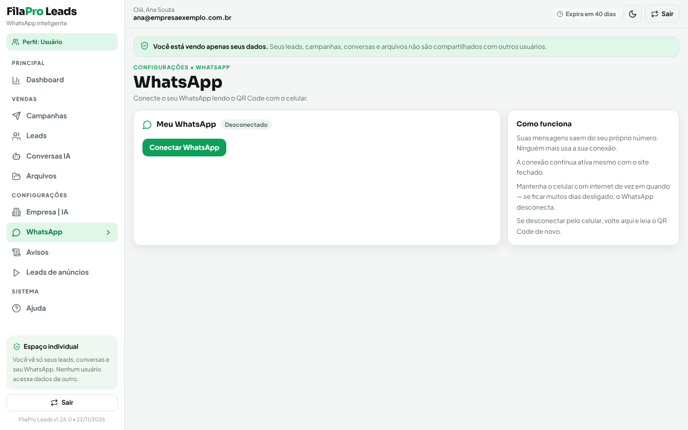

### Vários WhatsApps (só no plano Individual)

Se o seu plano permitir, a tela WhatsApp mostra um cartão para cada número e o botão **Adicionar mais um WhatsApp**:

- O plano permite até **4 números** (o principal + 3). Cada número a mais custa o valor do plano com desconto pela posição
  (ex.: 2º −10%, 3º −15%, 4º −20%) — dá para escolher a quantidade já na compra, no cartão do plano.
- Comprando no meio do período, o valor é **proporcional aos dias que faltam** para o plano vencer; o pagamento é por PIX.
- Na renovação você escolhe de novo quantos números quer; se diminuir, escolhe quais continuam.
- Depois que o pagamento é confirmado, o número novo aparece na tela para você ler o QR Code.
- Cada número pode ter um **apelido** (ex.: "Vendas 2") e mostra a própria saúde.
- Na campanha você escolhe por quais números enviar: os envios **alternam** entre eles, e cada número respeita os próprios limites.
- Quem responde continua a conversa **pelo número que recebeu**.
- Se um número cair, a campanha continua pelos outros e você recebe um aviso.

## Leads

Menu **Leads**: a sua lista de contatos.

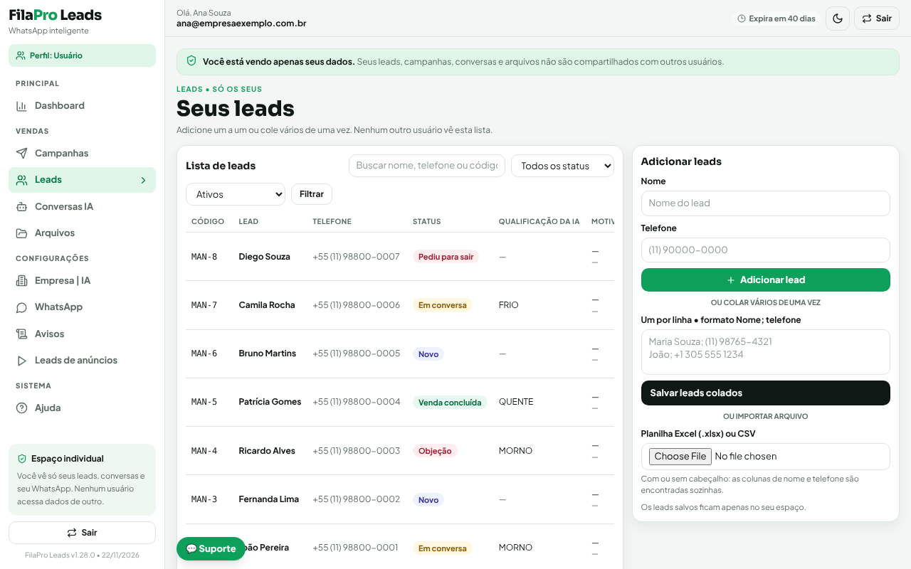

### Cadastrar leads

- **Um por vez:** nome (opcional) e telefone.
- **Colar uma lista:** cole linhas com nome e telefone.
- **Planilha:** arquivo Excel (.xlsx) ou CSV, até 10 MB. O sistema confere se a primeira linha é cabeçalho e mostra um
  resumo (quantos entram, repetidos, inválidos) **antes de salvar**.

Telefones do Brasil podem vir com ou sem o 55; números de outros países começam com **+** e o código do país.
O mesmo telefone não se repete: se outro usuário da empresa já cadastrou o número, o lead continua com quem cadastrou primeiro.

### Status do lead

| Status | Quando |
|---|---|
| Novo | Acabou de entrar |
| Em conversa | Respondeu ou está conversando |
| Qualificado | A IA identificou interesse claro |
| Objeção | A última fala foi uma objeção (preço, tempo…) |
| Venda concluída | Você marca quando vender |
| Bloqueado 24h | Recebeu mensagem há menos de 24 horas |
| Pediu para sair | Respondeu SAIR, PARAR, STOP ou CANCELAR |

O status muda sozinho com a conversa, e você também pode mudar à mão. Quem **pediu para sair** fica bloqueado para envio por 45 dias.
Você pode **inativar** um lead para ele não receber campanhas.

## Campanhas

Menu **Campanhas** → aba **Nova**. São 4 passos: **Mensagem → Leads → Antibloqueio → Prévia|envio**.
Você pode **Salvar rascunho** a qualquer momento.

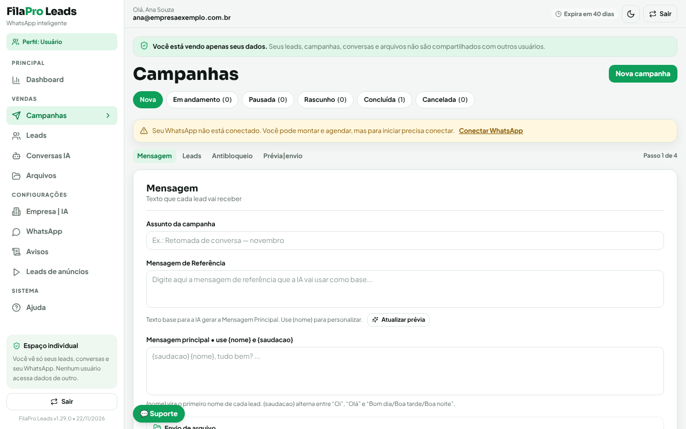

### 1. Mensagem

- **Mensagem de Referência:** escreva a ideia da mensagem e clique em **Atualizar prévia**: a IA escreve a **mensagem principal**
  (que você pode editar) e mais 3 variações usadas no envio, para as mensagens não ficarem todas iguais.
- Use **{nome}** (primeiro nome do lead) e **{saudacao}** (alterna entre "Oi", "Olá" e "Bom dia/Boa tarde/Boa noite").
- **Anexo** (opcional): imagem JPG/PNG até 5 MB, PDF até 15 MB, vídeo MP4 até 16 MB ou áudio MP3/OGG/M4A até 16 MB.

### 2. Leads

Escolha todos os leads ativos, filtre por status ou escolha um a um. A prévia mostra quantos vão receber e quem está bloqueado.

### 3. Antibloqueio

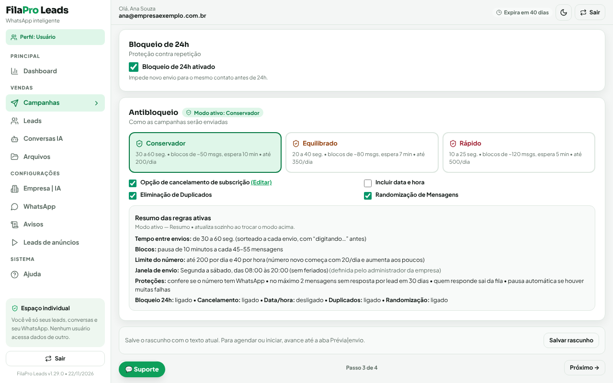

| Modo | Intervalo entre envios | Pausa | Limite por dia |
|---|---|---|---|
| Conservador (recomendado) | 30 a 60 s | 10 min a cada ~50 | 200 |
| Equilibrado | 20 a 40 s | 7 min a cada ~80 | 350 |
| Rápido | 10 a 25 s | 5 min a cada ~120 | 500 |

Proteções sempre ligadas: "digitando…" antes de cada mensagem, conferência de que o número tem WhatsApp, no máximo
2 mensagens sem resposta por lead em 30 dias, quem responde sai da fila, e **número novo começa devagar** (20 por dia nos primeiros dias).

Opções: **Bloqueio de 24h**, **texto de cancelamento** ("responda SAIR"), **data e hora**, **eliminação de duplicados**
e **randomização** das variações.

Os envios acontecem de **segunda a sábado**, sem feriados, dentro da **janela de envio** (no plano Empresarial, definida pelo administrador).

### 4. Prévia e envio

Confira o resumo e escolha **Agendar** (data e hora) ou **Iniciar**. O sistema pergunta se você quer ser avisado **sempre** que houver
problema na campanha ou só uma vez por dia de cada tipo.

### Acompanhar

Na lista de campanhas você vê o andamento e pode **Pausar**, **Retomar**, **Cancelar** ou **Duplicar** (campanhas concluídas).
A campanha pausa sozinha e avisa você quando o WhatsApp desconecta (e volta sozinha quando reconecta), quando há 5 falhas seguidas
ou quando mais de 30% dos números não têm WhatsApp.

## Conversas IA

Menu **Conversas IA**: todas as conversas com os leads, no estilo do WhatsApp Web.

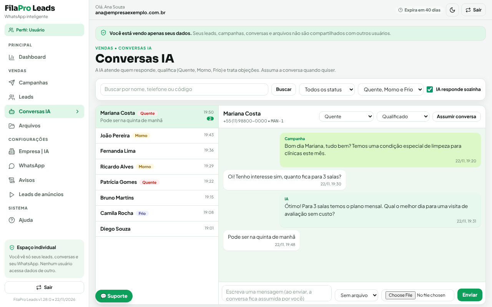

- **A IA responde sozinha**, a qualquer hora, de 20 a 60 segundos depois da mensagem do lead, com "digitando…".
- A cada resposta ela classifica o lead em **Quente** (quer comprar ou agendar agora), **Morno** (tem interesse, sem urgência)
  ou **Frio** (sem interesse), e marca o status (Em conversa, Qualificado ou Objeção).
- **Assumir conversa:** a IA para de responder aquele lead. **Devolver para a IA:** ela volta a responder.
- **Escrever uma mensagem** (com ou sem arquivo) também assume a conversa.
- Se a IA não souber responder (algo que não está no Empresa | IA), ela diz que vai confirmar, **pausa a conversa e avisa você**.
- **Áudio:** a IA não ouve; pede para o lead escrever e avisa você. **Imagem:** a IA lê.
- Limite de 30 respostas da IA por conversa por dia; depois disso ela pausa e avisa.
- A opção **IA responde sozinha** (no topo) liga ou desliga a IA para todos os seus leads.
- O histórico fica guardado por 365 dias.

## Arquivos

Menu **Arquivos**: os anexos que você usa nas campanhas e nas conversas. Um arquivo em uso por uma campanha ativa não pode ser excluído.

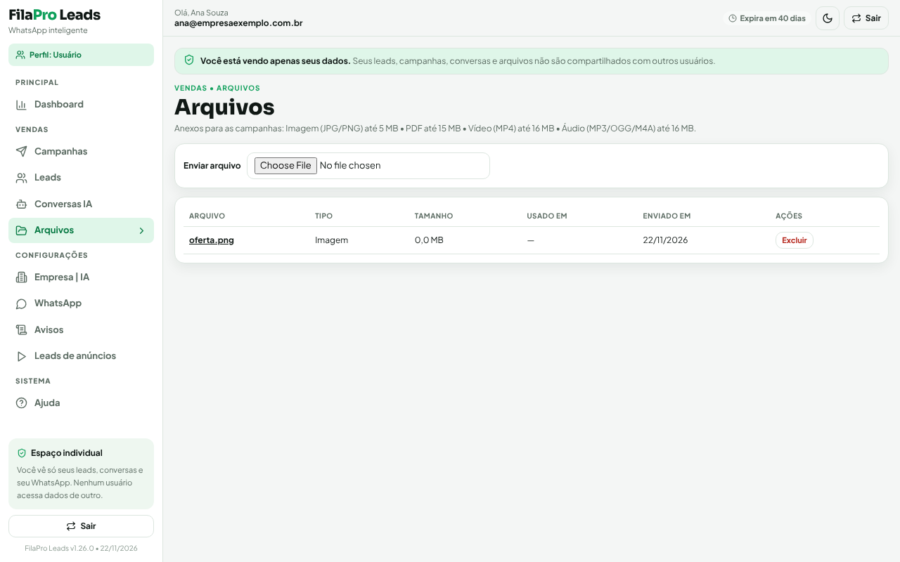

## Empresa | IA

Tudo o que a IA sabe sobre a sua empresa. No plano **Individual** você mesmo ensina; no **Empresarial**, só o administrador altera
e você vê.

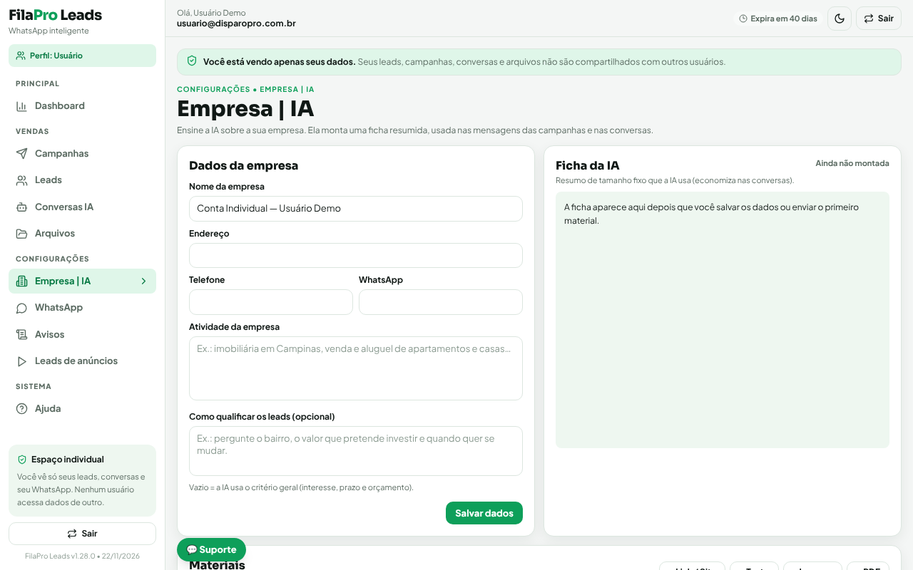

- **Dados da empresa:** nome, endereço, telefone, WhatsApp, atividade e, se quiser, **Como qualificar** (as perguntas que a IA deve fazer;
  ao clicar no campo, abre um editor grande no meio da tela, com **Salvar**, **Cancelar** e o botão **Texto sugestão**, que preenche
  um roteiro pronto — troque os textos entre colchetes pelas informações reais).
- **Materiais:** link ou site (até 20 páginas), texto, imagem (JPG/PNG até 5 MB) ou PDF (até 20 MB e 100 páginas).
  A IA lê, faz um resumo e monta a **Ficha da IA** — um resumo de tamanho fixo usado nas campanhas e nas conversas.
- **Esquecer:** a IA deixa de usar o material. **Ler de novo:** relê um site que mudou.
- O seu plano pode ter limite de materiais e de páginas por mês.

## Avisos e app no celular

Menu **Avisos**: escolha o WhatsApp que recebe os avisos e quais quer receber:

- **Lead qualificado (Quente)**;
- **Lead novo de anúncio**;
- **Lead respondeu** (menos SAIR/PARAR/STOP/CANCELAR).

Os avisos saem pelo número do FilaPro Leads. Muitos avisos juntos viram **um resumo**: o primeiro chega na hora e os seguintes,
em até 10 minutos, chegam juntos.

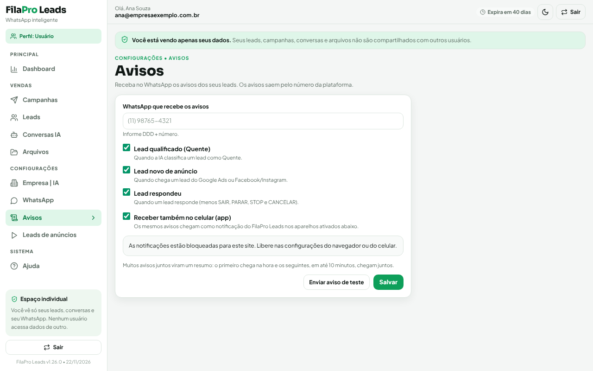

### Instalar o app no celular

O jeito mais fácil: abra **filaproleads.com.br** no celular e toque em **Instalar app**, ao lado de **Planos**, na tela de login.

- **Android (Chrome):** o botão **Instalar app** instala direto, na janela do Chrome. Se o botão não aparecer, o app já está
  instalado (abra pelo ícone) ou o Chrome ainda não liberou a instalação; nesse caso use o menu ⋮ → **Instalar app**.
- **iPhone (Safari):** **Compartilhar** → **Adicionar à Tela de Início**, e abra pelo ícone (iOS 16.4 ou mais novo para notificações).

Depois, em **Avisos**, marque **Receber também no celular (app)** e toque em **Ativar notificações neste aparelho**.
Use **Enviar aviso de teste** para conferir.

## Leads de anúncios

Recurso pago, disponível se estiver incluído no seu plano. Leads do **Google Ads** e do **Facebook/Instagram** (via Make ou Zapier)
entram sozinhos na sua lista e **a IA já manda a primeira mensagem** sobre o assunto do formulário.

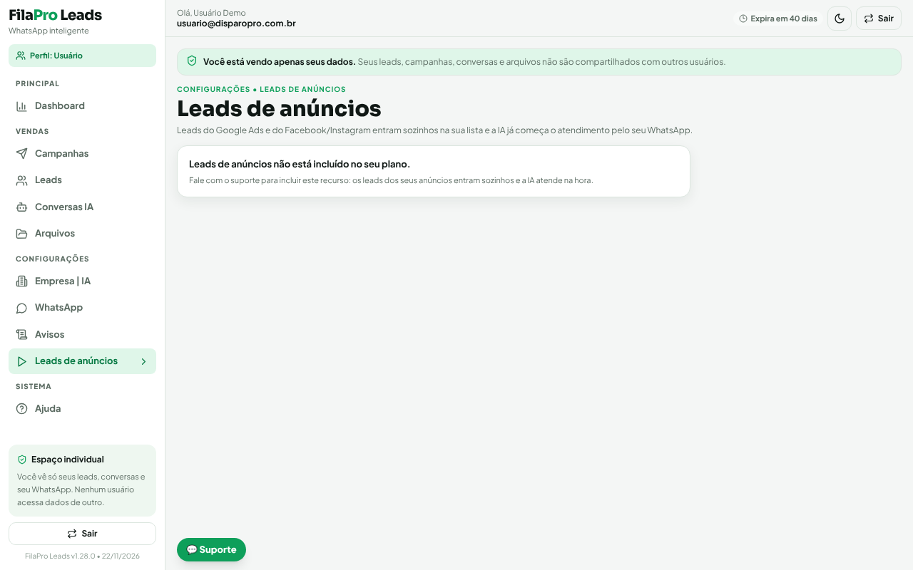

1. Menu **Leads de anúncios** → **Gerar meu endereço** → **Copiar**.
2. **Google Ads:** no formulário de lead da campanha → Integração de dados → Webhook → cole o endereço.
3. **Facebook/Instagram:** no Make ou Zapier, gatilho "Facebook Lead Ads → Novo lead" e ação HTTP POST para o endereço,
   com os campos `nome`, `telefone`, `email` e `assunto`.
4. A lista **Últimos leads recebidos** mostra cada lead e a situação (IA atendeu, esperando o WhatsApp, sem telefone…).

Não compartilhe o endereço. Se precisar, use **Gerar novo endereço** — o antigo para de funcionar na hora.

## Suporte

O botão **💬 Suporte**, no canto de baixo da tela, abre um chat com o suporte do FilaPro Leads:

- escreva a dúvida e, se quiser, anexe uma **imagem (JPG/PNG) ou PDF** de até 15 MB;
- a resposta aparece na hora, no mesmo chat; o número vermelho no botão mostra mensagens novas;
- se o suporte quiser falar com você, o chat **abre sozinho** na sua tela (e chega uma notificação no celular, se ativada em Avisos);
- a conversa fica guardada por 365 dias. No plano Empresarial, o administrador **não vê** as suas conversas com o suporte.

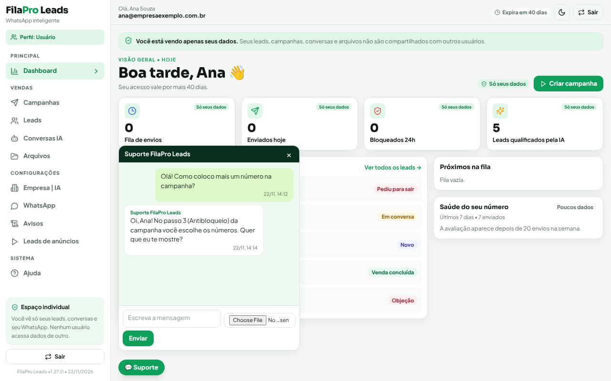

## Mensagens do FilaPro Leads

Às vezes aparece uma **mensagem no centro da tela** (manutenção, novidades, avisos importantes). Leia e clique em **OK** para fechar —
ela não aparece de novo. Se você estava fora do sistema, ela aparece no próximo acesso.

## Sistema em atualização

Quando o FilaPro Leads recebe uma versão nova, aparece a tela **"Sistema em atualização"** por alguns minutos. Nesse tempo nada pode
ser alterado, mas nada se perde: **as campanhas param e continuam de onde pararam**, as respostas da IA saem logo depois e o texto
que você estava escrevendo no Suporte fica guardado. A tela some sozinha quando termina.

## Perguntas frequentes

**A IA respondeu algo errado. O que faço?**
Clique em **Assumir conversa**, corrija com o lead e ensine a informação certa no **Empresa | IA**.

**O lead pediu para sair. Posso mandar de novo?**
Não pelos próximos 45 dias. Depois disso, você decide na campanha se ele entra.

**Minha campanha parou sozinha.**
Veja o motivo na lista de campanhas (WhatsApp desconectado, falhas, limite do dia, fora do horário, disparos do período acabaram).
Você também recebe o aviso no WhatsApp.

**Posso usar no celular?**
Sim: instale o app (veja *Avisos e app no celular*).
